# 摘要

公共充电的使用数据分散在各运营商手中，而充电桩与运营商后台（CSMS）之间的 OCPP 控制通道正成为可被集中操纵的攻击点。已有研究要么在电网尺度把攻击抽象成一个"受控比例 *p*"，却不回答 *p* 如何从网络层得到；要么用实验室脚本流量训练入侵检测，与真实城市充电的站点规模和日节律相去甚远。本文以巴塞罗那大都会区（AMB）真实的运营商结构与真实充电流量为底座，提出一个**全部集中在网络层**的 OCPP 攻防仿真框架，并配以真实地理底图上的攻防可视化：电网只作结果指标，不建潮流模型。框架用 2025 全年约 13.1 万次真实会话驱动 71 个站点的 OCPP 消息流，用配套需求论文的"规模×节律"分解为另外 550 个登记站点合成背景流量，并把同一分解转用为后台侧的物理一致性检测器。基于真实数据的定量表明：AMB 范围 3,302 个充电点、37 家运营商合计额定功率 63.47 MW（直流 35.96 MW），仅为西班牙本土电网峰值（约 40 GW）的 0.16%，远低于触发低频减载（UFLS）所需的 9–11%，印证"电网只宜作结果指标"；可控功率在运营商间高度集中（Gini 0.70，前 10 家后台≈80% 功率），攻破单家后台可控 2.6–12.3 MW；3,053 个充电点（92.5%）接受 RFID，使凭据克隆成为现实攻击面，而链路加密只能压制中间人与克隆类（A1/A2）、对后台攻陷与 DoS（A3/A4）无效；傍晚 18 时会话到达为日均 2.0 倍，后台中断 3 小时在该时段最多拒绝约 89 次/日会话；物理一致性检测器可把 2025-04-28 大停电（全网同步降至期望的 0.53）与单站伪造电表读数区分。本文以"被发现前造成的损失"（MWh、被拒会话、受影响市镇）为主评价指标，并以 22 幅融合图（含 6 幅 GIS 攻防可视化）在 H3 功能分区底图上回放攻防全过程。在真实 OCPP 1.6 仿真平台上的实测（57 站真实会话）进一步表明：仅检测不减损失，叠加隔离可把被发现前的受控电量从约 2,100 kWh 降至约 6–10 kWh（>99%），规模×节律一致性检测器能在约 1 分钟内捕获速率检测漏掉的隐蔽慢速攻击，良性回放误报为 0。

**关键词：** 电动汽车充电；OCPP；CSMS；网络层攻防仿真；GIS 可视化；入侵检测；关键基础设施安全；巴塞罗那

# 1 引言

公共充电网络正在欧盟城市快速扩建。《替代燃料基础设施法规》（AFIR）要求运营商经各成员国的国家接入点公开充电点的静态与动态信息[1]，其实施条例进一步细化了数据可用性口径[2]；但出于隐私与商业考虑，真实充电会话通常不在公开之列，面向真实流量的充电网络安全研究因此长期缺乏底座。与此同时，针对充电接口物理层与无线层的攻击已被反复证实——从对 CCS 链路的无线中间人注入到对充电会话的广域干扰[3,4,5]——但这些工作大多止步于单桩或单链路，难以回答"在一座城市的真实充电网络里，一次入侵能横向扩散到多大范围"。

本文把研究单位收敛到充电桩（EVSE）与运营商后台（CSMS）之间的 OCPP 控制通道[6,7]。理由有三：OCPP 是运营商向充电桩下发功率限制、远程启停与计费指令的事实标准通道，攻击者一旦进入，其行为可直接映射为可度量的结果；一座城市的 OCPP 会话由有限几家运营商后台汇聚，天然带有"桩—后台—运营商"的层级拓扑，使"攻击者处在通道的哪个位置、能波及多少站点"成为可刻画、可上地图的问题；相较物理层，网络层攻防更贴近运营商当前真实可部署的检测与遏制手段。

现有工作留下两处空白。其一，电网尺度研究通常把攻击抽象成一个"受控比例 *p*"：配套仿真研究[8]给出 2024 年欧洲大陆尺度 *p*≈0.8%，需升至约 9–11% 才触发 UFLS，却不回答 *p* 如何从网络层获得。其二，用于训练入侵检测的数据集多依赖实验室脚本流量[9,10]，缺乏真实城市充电的站点规模差异与日节律，检测器在真实流量上的误报行为未经检验。

本文不以"操纵电网"为主线。本研究据 DGT 国家接入点登记表复算，AMB 范围内 37 家运营商、3,302 个充电点合计额定功率仅 63.47 MW（直流 35.96 MW）；即便完全控制，相对西班牙本土约 40 GW 量级峰值也仅 0.16%，在系统频率层面不成立（图 19），与[8]一致。因此电网仅作结果指标，不建潮流模型。

**研究问题：** 在巴塞罗那真实的运营商结构与真实充电流量下，攻击者从 OCPP 通道的不同位置实际能控制多少站点、多少 MW、拒绝多少会话；防御方又能多快发现并遏制？协议版本与安全配置作为情景变量。**贡献：**（1）以真实拓扑与真实流量为底座的网络层 OCPP 攻防仿真；（2）把"规模×节律"分解一物两用——背景流量生成器 + 物理一致性检测器；（3）以"被发现前造成的损失"为主评价指标，并用 22 幅融合图（含 6 幅 GIS 攻防可视化）在真实地图上回放攻防全过程。第 2 节给出数据与协议背景，第 3 节威胁模型与仿真底座，第 4 节攻击面与可控性，第 5 节检测与遏制，第 6 节实验设计，第 7 节 GIS 可视化与工具链，第 8 节讨论与结论。

# 2 相关工作与数据基础

## 2.1 OCPP 协议与安全

OCPP 是 EVSE 与 CSMS 之间事实上的标准控制协议，其版本差异直接决定网络层攻防的门槛。OCPP 1.6 提供 SOAP（1.6S）与 JSON（1.6J）绑定，传输层加密为可选、设备认证较弱；虽有官方安全扩展定义三级安全配置，但是否启用取决于部署而非协议强制[6,12,13]。OCPP 2.0.1 引入证书认证、结构化安全配置档并强制 TLS[7,12]。OCPP 2.1（IEC 63584-210:2025）面向 V2X/DER 的双向能量交互并新增授权与支付机制[14]；1.6 与 2.1 消息模型不兼容。对本文最关键的是：1.6 报文的可篡改性与缺乏计量完整性约束，使"协同功率操纵"在协议层几乎没有门槛。因此本文把协议版本与安全配置作为情景变量纳入仿真矩阵。"巴塞罗那现网以 OCPP 1.6 运行、Endolla Barcelona 计划升级至 2.0"一说本文未查得权威出处，仅作情景假设。

## 2.2 相关安全数据集的定位

现有公开数据集均未覆盖"真实运营商结构 + 真实充电流量 + OCPP 消息级攻防"这一交集：**CICEVSE2024** 含功耗、网络与主机 HPC/内核指标，但攻击为实验室脚本且非 OCPP 消息级[9]；**联邦 OCPP 1.6 数据集**聚焦 OCPP 应用层四类攻击，但流量同样出自实验室脚本[10]；**Current Affairs（CCS 测量）**实测 325 台真实直流桩、仅约 12% 启用 TLS，但对象是车↔桩链路[5]；**DCeption/Brokenwire** 针对 CCS HPGP 的无线中间人与功率遥测篡改，停留在车↔桩物理层[4,3]；**PowerBench Part 3** 为 OpenDSS 电网仿真数据，属配电物理层[15]。本文的定位正是补上该交集（数据集详表见附录 E）。

## 2.3 AMB 数据基础

配套需求论文[11]及其派生图层为本文提供真实底座（图 1）。**节点底座**：71 个 AMB 网络站点有 2025 全年清洗会话（131,285 条清洗记录，[11]报告 131,267 次，差异为清洗口径；总电量 1.97 GWh）；由 DGT DATEX II 登记表裁剪、按同一运营商 50 m 内合并得 550 个其他运营商站点，连同 71 个共 621 个站点。**登记表复算**（2026-09-27 快照）：855 条站点记录、3,302 个充电点、4,733 个接口、37 家运营商（按运营商编号；DGT 解析说明按名称记 38 家，差异源于归并口径）。71 个 AMB 会话站点有 33 个登记在 DGT 中、运营商均为 **Iberdrola Clientes**（98 充电点、3.74 MW），其余 38 站不在 DGT。**可复用模型**："规模×节律"分解在本文一体两用（第 3、5 节）：仅站点规模即解释约 64% 会话偏差、73% 电量偏差，加节律与设施状态升至约 68%，上限约 83%。真实数据中的若干异常（4-28 大停电、11-30 与 12-11 全网缺口）为检测器提供了实验室流量所不具备的"假阳性"考验。

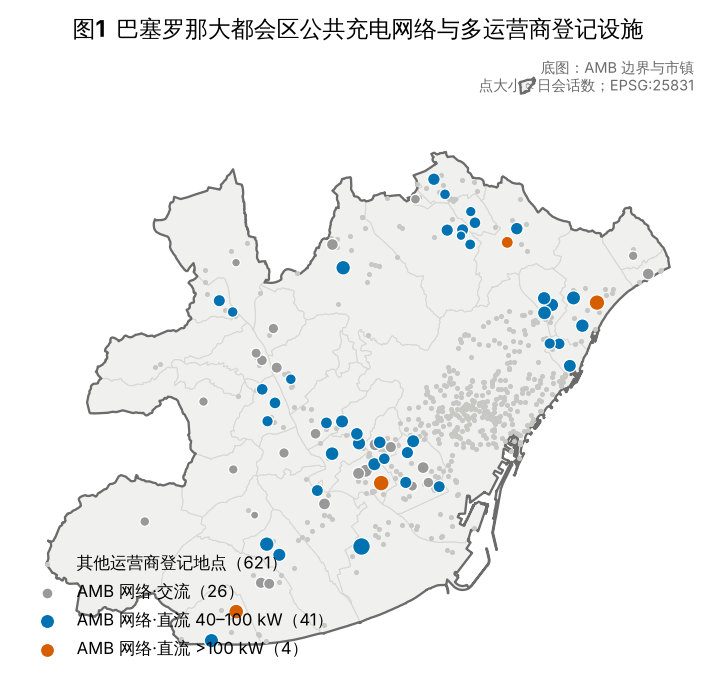{width=78%}

**图 1** AMB 公共充电网络与多运营商登记设施。71 个 AMB 站点（按设施配置着色、点大小∝日会话数）分布在巴塞罗那市以外；灰点为 621 个登记地点中的其他运营商设施，密集团块为市中心。

# 3 威胁模型与仿真底座

全部攻击仅在隔离仿真环境内复现，不接触任何真实充电桩、运营商后台或配电系统。

## 3.1 系统与节点模型

仿真拓扑含 621 个站点：71 个 AMB 站点具真实会话，550 个其他运营商站点仅含位置、额定功率与认证方式[11,2]。每家运营商各自接入其 CSMS，EVSE 与 CSMS 之间以 OCPP over WebSocket 承载控制通道[6,7]。电网仅作结果指标，不建潮流或频率模型；受控功率上限因而可由登记表额定功率静态推算，作为"完全控制"情形的上界（第 4 节）。作为量级对照，AMB 网络按会话时长均摊电量重建的平均功率约 0.22 MW、平均日负荷峰值约 0.40 MW（瞬时并发更高，见附录图 A2）；即便受控规模达上界 63.47 MW，相对本土约 40 GW 仍属千分之一量级（图 19）。

## 3.2 正常流量生成

对 71 个 AMB 站点，将每条会话映射为 OCPP 消息序列作为基线流量：桩上线发 BootNotification 并周期发 Heartbeat；会话以 RFID/App 凭据发起 Authorize，获授权后 StartTransaction 上报 meterStart，期间周期发 MeterValues，结束以 StopTransaction 上报 meterStop；桩态变化触发 StatusNotification[6,16]。原始记录仅含起止时刻与总电量，会话内功率曲线须在假设下重建，该假设在敏感性分析中单列。对 550 个无会话站点，用"规模×节律"合成背景流量；因以其他运营商拟合的部署模型给 AMB 站点打分 AUC 仅 0.26（排序几近相反）[11]，合成流量仅作可信负荷占位，其不确定性随攻防指标一并报告。

## 3.3 真实异常作为假阳性考验

本文保留若干"貌似攻击的真实异常"用作假阳性考验（图 14）：2025-04-28 伊比利亚大停电当日会话约为平常一半（146 次 vs 邻周 285.8 次，比值 0.51），形态近似协同停充；1–2 月后台迁移导致充电点编号批量更换，形态近似身份克隆；11-30 与 12-11 全网零记录缺口，形态近似连接中断。检测器必须将其判为良性。这也是把"规模×节律"兼用作检测器的动因：唯有把判据建立在站点规模与当日节律的**联合**期望上，才能把停电下的"全网同步低于期望"与攻击下的"单站偏离期望"区分开（图 14）。

## 3.4 威胁模型与假设

攻击者能力随链路配置变化（图 2）。在未加密或未互认的 OCPP/WebSocket 链路上，赋予攻击者 Dolev–Yao 式能力；随 TLS、客户端证书或双向认证启用，该能力收缩为仅可观察时序或仅可发起连接层洪泛[6,7,12,13]。信任假设：EVSE 固件完整；CSMS 为合法策略权威但本身可被攻破并用作攻击位置。攻击者目标归为功率操纵、偷电、拒绝/可用性破坏三类。范围严格限于仿真——以 SteVe/CitrineOS 为后台、ocpp 库回放客户端、Mininet 搭拓扑、mitmproxy 注入的隔离环境[16,17,18,19,20]。

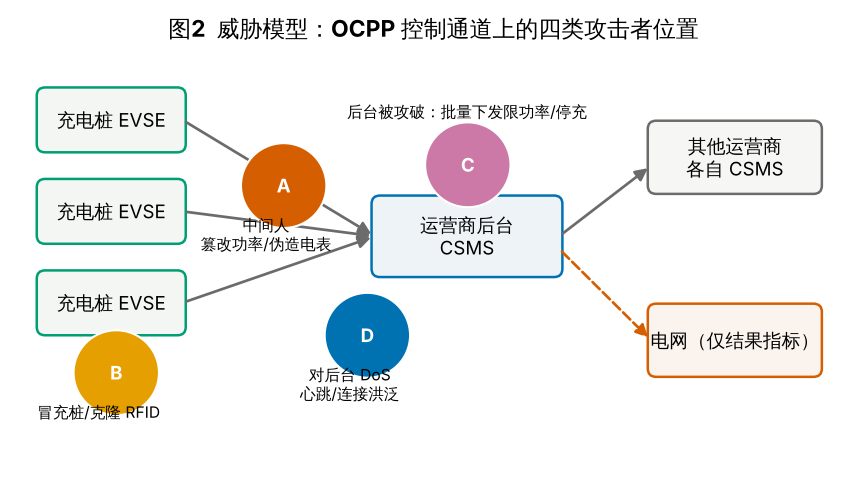{width=82%}

**图 2** 威胁模型：OCPP 控制通道上的四类攻击者位置。A 中间人、B 冒充桩/克隆 RFID、C 后台被攻破、D 对后台 DoS；电网仅作结果指标（虚线）。

# 4 攻击面与可控性度量

## 4.1 攻击面：位置与地理分布

**表 1** 四类攻击者位置的 OCPP 层机制与结果指标。

| 攻击者位置 | OCPP 层机制 | 结果指标 |
|---|---|---|
| A 桩-后台中间人（未加密链路） | 篡改 SetChargingProfile 功率上限、改写 MeterValues、伪造/截停 RemoteStopTransaction | 被改功率站点数、计费偏差（€） |
| B 冒充桩/克隆 RFID | 伪造 BootNotification 注册、重放 Authorize | 偷电量（kWh）、虚假占用 |
| C 后台（CSMS）被攻破 | 单点向大量桩扇出 SetChargingProfile 限功率或 RemoteStop | 可控 MW、被拒会话数、受影响市镇数 |
| D 对后台拒绝服务 | Heartbeat 或 WebSocket 连接洪泛 | 失联站点数、离线期间会话数 |

攻击面首先是一个地理问题。图 3 把 621 个登记地点按直流能力着色：高功率直流桩（>100 kW）功率高、分布集中，是协同功率操纵的高价值目标；图 4 进一步叠加 H3 功能分区，显示这些直流桩集中在工业物流与交通走廊区，而高密度居住区以交流为主。因此攻击者在地图上并非均匀面对 621 个站点，而是面对若干高价值的直流集群。

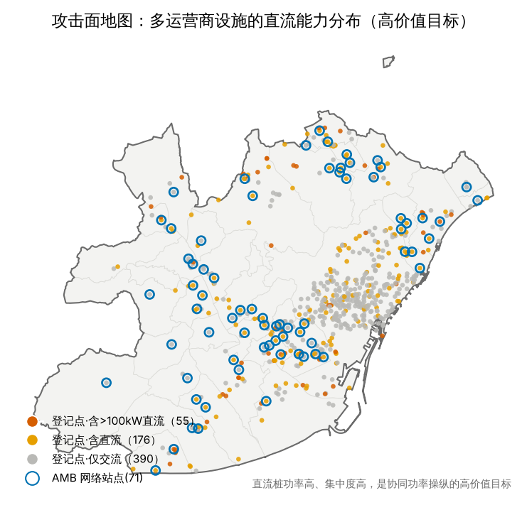{width=72%}

**图 3**（GIS）攻击面地图：多运营商设施的直流能力分布。红点为含 >100 kW 直流的高价值目标，蓝圈为 71 个 AMB 网络站点。

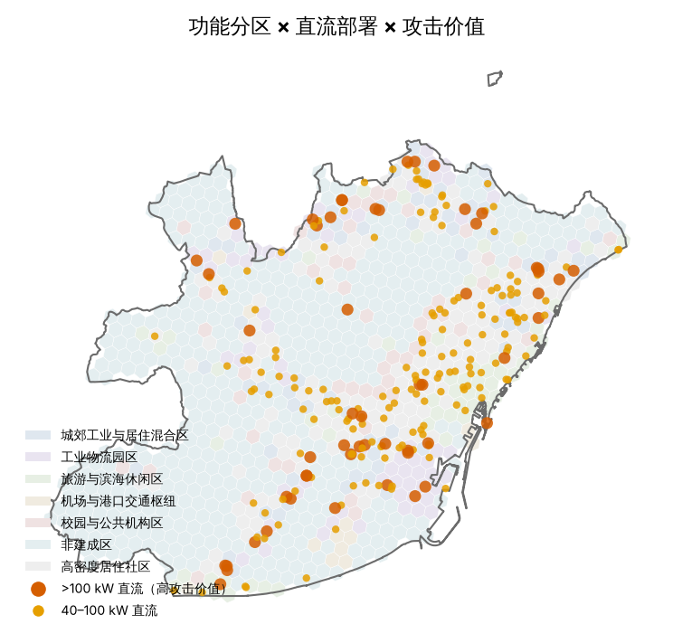{width=70%}

**图 4**（GIS）功能分区 × 直流部署 × 攻击价值。H3 功能分区为底色，直流桩按功率档着色，高价值直流集中于工业物流与走廊区。

## 4.2 可控性度量与可达性

设攻击者位置 *a*、安全配置 *c*。定义**可达集** *R*(*a*,*c*) 为该位置、配置下可影响的充电点集合；在其上定义受控站点数 *N*、**可控 MW** *P*=Σ*P*~rated~、被拒会话数 *D*、受影响市镇数 *M* 与计费偏差。可控 MW 的上限由登记表给定（图 5）：全体 ≤ 63.47 MW、直流 ≤ 35.96 MW（直流占总功率 56.7%）；按功率降序攻破约 5 家后台即达全网约八成直流功率。认证侧，3,053 个充电点（92.5%）接受 RFID、2,897 个（87.7%）为"rfid;apps"组合，使 B 类克隆现实可行。

可达性是"位置×配置"的函数（图 6）：链路加密（wss/TLS、双向证书）可把中间人（A1）的可达功率从上限 63.47 MW 压到 0、把 RFID 克隆（A2）在 2.1 Plug&Charge 下由 3,053 点压到约 305 点；但后台被攻破（A3）与连接层 DoS（A4）不依赖链路机密性，无论协议版本如何都可达目标运营商整支机队。这把[8]抽象的"受控比例 *p*"翻译成了"需攻破几家后台、以何种配置、可达多少 MW"的网络层问题。须强调可控 MW 是**上限/恒等式**意义的量，并非电网后果（图 19）。

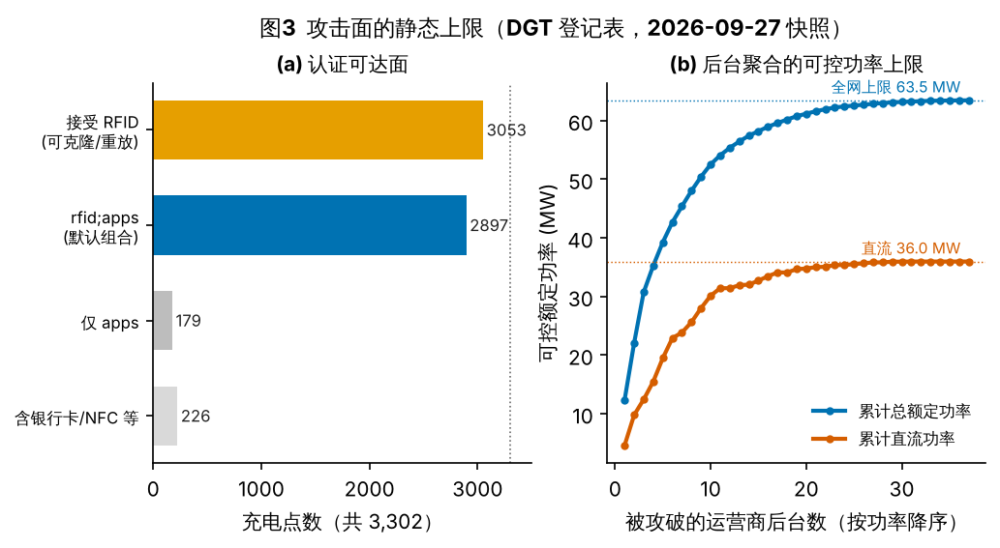{width=92%}

**图 5** 攻击面的静态上限（DGT 登记表）。(a) 认证可达面：3,053 点接受 RFID；(b) 后台聚合的可控功率：约 5 家后台即达全网八成直流功率，全网上限 63.47 MW。

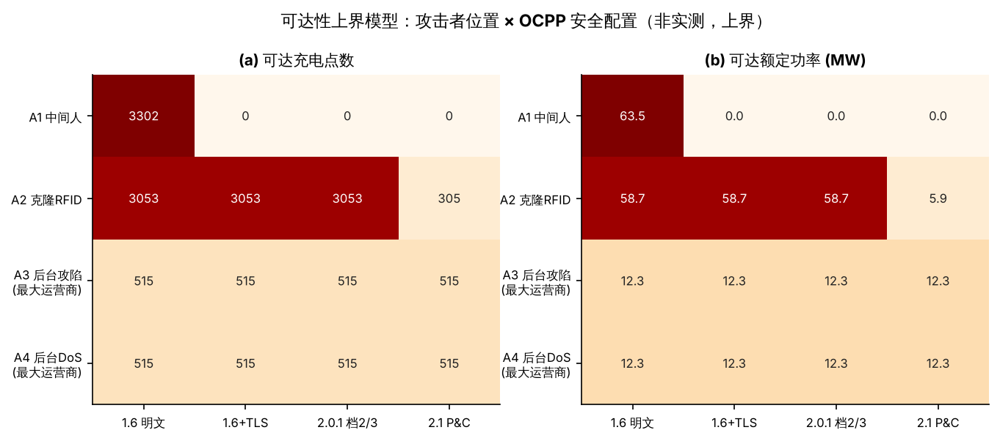{width=92%}

**图 6** 可达性上界模型：攻击者位置 × OCPP 安全配置。加密压制 A1/A2，但对 A3（后台攻陷）与 A4（DoS）无效。

## 4.3 爆炸半径与集中度

后台被攻破的后果取决于该后台机队的规模与地理覆盖。攻破单家后台可控 2.6–12.3 MW（图 7）：Endesa X Way 12.33 MW、Iberdrola Clientes 9.75 MW（AMB 网络所属后台）、BSM 8.67 MW。但地理爆炸半径差异巨大（图 8）：Endesa 覆盖 18 个市镇、Iberdrola 覆盖 31 个市镇（最广）、而 BSM 虽功率相当却集中在市中心 2 个市镇。可控功率在运营商间高度集中（图 9，Gini 0.70）：前 10 家后台即聚合约 80% 的额定功率，意味着少数后台的安全态势决定了全网的可操纵规模。

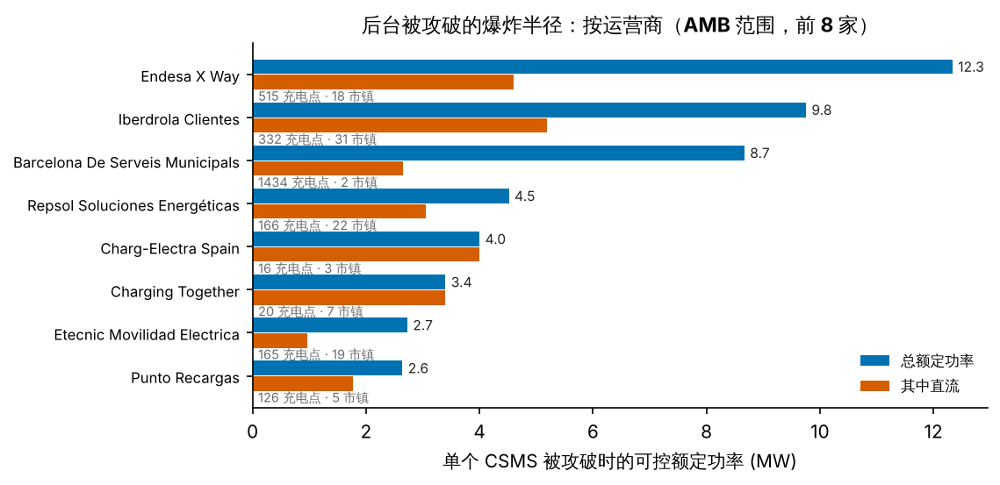{width=84%}

**图 7** 后台被攻破的爆炸半径（前 8 家运营商）：单个 CSMS 被攻破时的可控额定功率（总/直流）及其充电点数与覆盖市镇数。

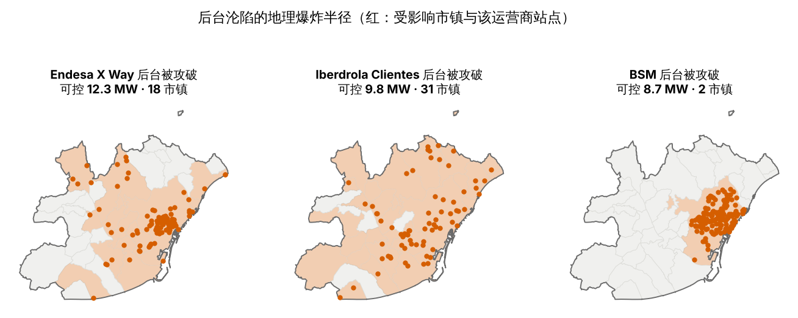{width=98%}

**图 8**（GIS）后台沦陷的地理爆炸半径。红色为受影响市镇与该运营商站点；三家功率相近的后台，地理覆盖面从 2 个到 31 个市镇不等。

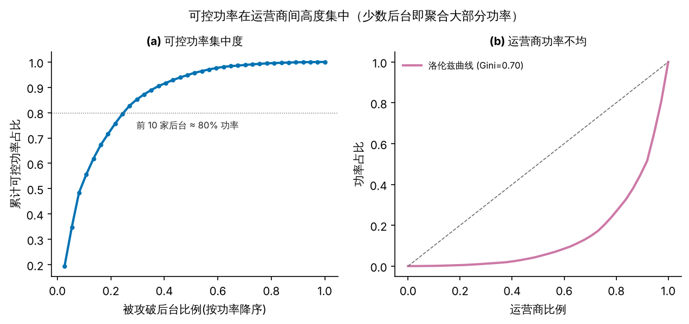{width=92%}

**图 9** 可控功率的运营商集中度。(a) 前 10 家后台≈80% 功率；(b) 洛伦兹曲线，Gini 0.70。

# 5 防御：检测与遏制

与攻击侧一致，全部检测与遏制逻辑置于网络层与 CSMS，电网量仅作结果指标。本节给出检测器构造与指标形式化；这些检测与遏制已在真实 OCPP 1.6 仿真平台上实现并运行，实测结果在第 6 节报告（平台见 6.3 节与附录 D）。

## 5.1 时间暴露与 DoS 的时空分布

防御的紧迫性取决于真实流量的时间暴露（图 10、图 11）。工作日会话到达在 18 时达日均 2.0 倍，45.4% 的会话在 12–19 时开始（图 10a、图 11）；因此对 AMB 网络（Iberdrola 后台）的一次拒绝服务，被拒会话强烈依赖攻击时刻——中断 3 小时在傍晚最多拒绝约 89 次/日会话，深夜不足其 1/4（图 10b）。把该时间维投影到地理上（图 12），傍晚后台中断的被拒会话集中在机场物流区与若干高需求市镇。这说明"被发现前的损失"不仅取决于遏制速度，也取决于攻击落在节律与地理的哪一段。

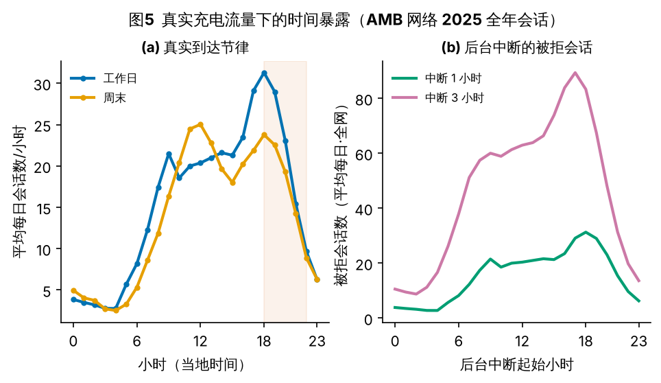{width=92%}

**图 10** 时间暴露（AMB 网络 2025 全年会话）。(a) 工作日/周末到达节律；(b) 后台中断 1/3 小时在不同起始时刻的被拒会话数。

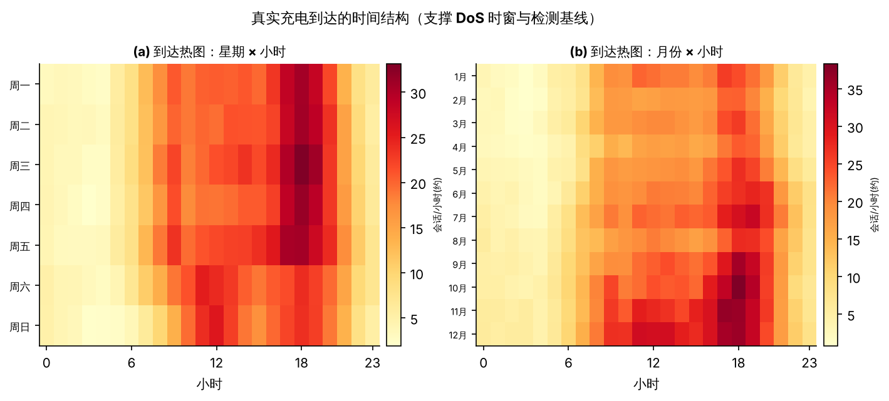{width=94%}

**图 11** 真实充电到达的时间结构。(a) 星期×小时；(b) 月份×小时。工作日傍晚与全年增长清晰可见，是 DoS 时窗与检测基线的依据。

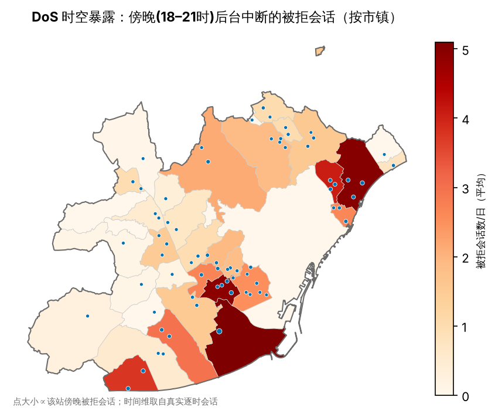{width=66%}

**图 12**（GIS）DoS 时空暴露：傍晚（18–21 时）后台中断的被拒会话（按市镇）。时间维取自真实逐时会话。

## 5.2 检测（后台侧）

检测融合两路特征：传输层流量特征由 NFStream 从 OCPP/WebSocket 连接提取（包/字节速率、到达间隔、连接频繁建断、心跳节律），识别 DoS 洪泛与中间人痕迹；OCPP 消息层特征包括消息类型序列、远程控制指令下发节律、授权/重放模式与 MeterValues 内部一致性[20]。

核心检测器把"规模×节律"分解转为**物理一致性检验**。站点 *s* 在时片 *t* 的期望电量 *Ê*(*s*,*t*)=scale*~s~*·ρ(*t*)·*g*(*s*,*d*)；以观测/期望比 *r*=*E*~obs~/*Ê* 为判据：伪造电表读数或把功率推出"规模×当日节律"包络之外都会使 *r* 越过正常带。图 13 在真实日序列上展示其行为——4-28 大停电使**全网同步**降至期望的 0.53（全站一致→判为良性、须白名单），而注入的伪造电表读数在**单站**使比值冲高越过上带（告警）；二者的区分正来自"规模×节律"的联合期望。跨运营商联邦检测使各运营商日志本地化、仅共享模型参数与异常统计[10,21]，契合多运营商结构。所有检测器须通过第 3.3 节三类真实异常的假阳性考验并单独报告误报率。

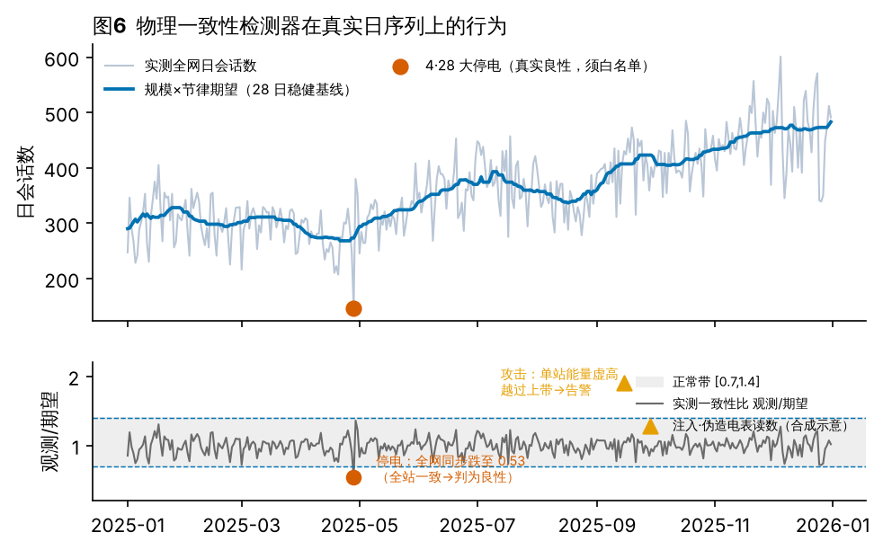{width=90%}

**图 13** 物理一致性检测器在真实日序列上的行为。上：全网日会话数与"规模×节律"28 日稳健基线（会话 1 月 9,578→12 月 14,330 次）；下：观测/期望一致性比，4-28 大停电全网同步跌至 0.53（良性）、注入的伪造电表读数单站冲高越过上带（告警）。

## 5.3 遏制与评价主指标

遏制手段建模为情景变量：加密与认证等级、远程功率/停充指令限速（据[8]有效）、按运营商或区域隔离、跨运营商联邦检测。主指标为"被发现前造成的损失"而非仅 AUC：累计受控电量（MWh）、被拒会话数、受影响市镇数。定义检测时延为攻击注入到首次正确告警的时间，损失即检测时延沿攻击功率曲线的积分。三量全部可在 H3 功能分区底图上随时间轴回放（第 7 节图 18）。

# 6 实验设计与评估

本节在真实 OCPP 1.6 仿真平台上实测防御效果：真实会话经真实 OCPP 消息回放，攻击与检测/遏制在隔离环境中实际运行，所报数值为跨重复运行的实测中位数（平台见 6.3 节、附录 D）。

## 6.1 攻击目标的异质性

不同接口的攻击价值不同（图 14）：直流桩中位时长仅 27–28 min 但中位功率达 48–86 kW、电量 18–27 kWh，是功率操纵与偷电的主要目标；交流 Schuko 中位 114 min、仅 2.2 kW，攻击价值低。各接口的增长也不同步（图 15）：直流会话全年增至 1.67 倍、交流 Type2 1.25 倍，而 Schuko 降至 0.77 倍，意味着负荷构成随时间变化、防御规则须定期更新。

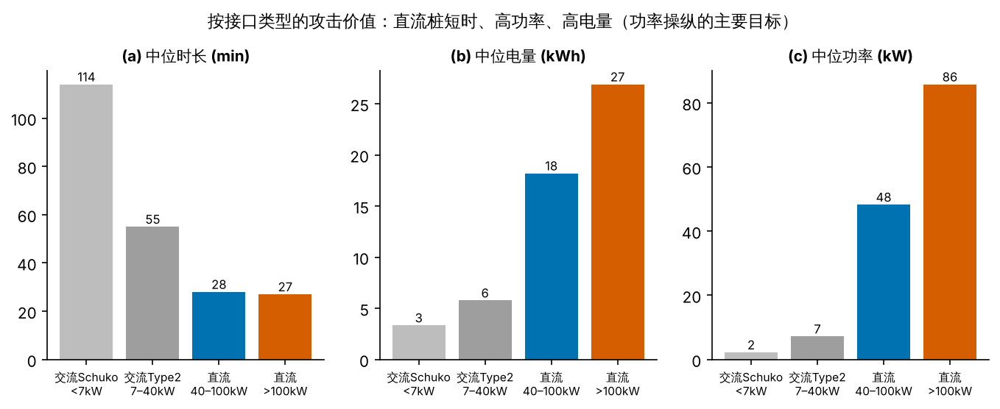{width=94%}

**图 14** 按接口类型的攻击价值：直流桩短时、高功率、高电量，是功率操纵的主要目标。

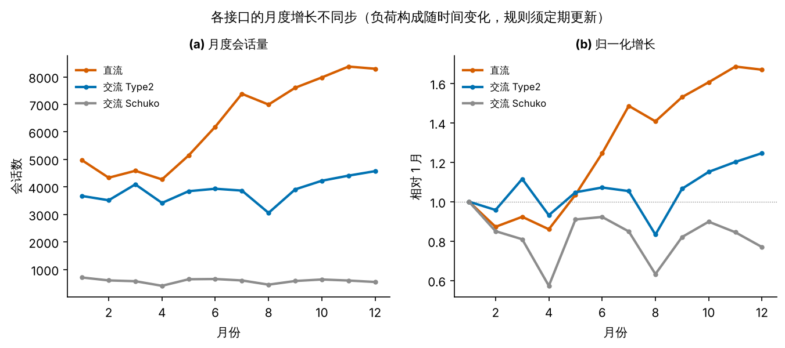{width=92%}

**图 15** 各接口月度增长不同步：直流增长最快、Schuko 下降，负荷构成随时间变化。

## 6.2 场景矩阵、指标与权衡

实验在四维笛卡尔积上展开（完整取值见附录 B）：攻击者位置 *A*∈{A1–A4}；OCPP 版本与安全配置 *V*；防御配置 *D*∈{无防御、加密认证、指令限速、隔离、联邦检测、规模×节律一致性检测}；攻击规模与协同度 *C*。设攻击在 *t*₀ 注入、*t_d* 首个真阳性告警、*t_c* 遏制到阈值；度量检测时延 τ_d、遏制时间 τ_c、残余损失（ΔE、N_rej、|M|）、计费偏差与误报率（形式化见附录 C）。在该平台上实测（代表日 2025-12-05 傍晚 16–22 时、57 个有会话的 AMB 站点、每格 3 次重复），结果给出三点（图 16、图 17、图 A1）。其一，**检测必须配合遏制**：仅检测（D5）与无防御（D0）的被发现前残余受控电量同为约 2,100 kWh，而叠加隔离（D3+D5）后降至约 6–10 kWh（降幅 >99%）。其二，**规模×节律一致性检测器**捕获了指令速率检测漏掉的隐蔽慢速攻击（3 指令/分），约 1 分钟内告警；快速攻击由速率检测在 0–1 分钟内捕获。其三，单用限速（D2）而不隔离几乎不减损失（攻击仍最终波及全部 57 站），但限速叠加隔离把爆炸半径压到约 6 站、峰值受控功率从约 0.89 MW 降到约 0.23 MW。四次良性回放的误报为 0。

**6.3 仿真平台。** 平台用 Python `ocpp` 库[16]实现真实 OCPP 1.6 消息（BootNotification/Authorize/StartTransaction/MeterValues/StopTransaction/Heartbeat，以及 CSMS→桩的 SetChargingProfile/RemoteStopTransaction）；57 个充电桩异步客户端经真实 websocket 连至一个 CSMS，按 2025-12-05 的真实会话回放，采用离散虚拟时钟（1 分钟步进）与墙钟解耦。A3 后台沦陷攻击向各桩扇出限功率/停充（快速 30、隐蔽 3 指令/分）；后台侧检测器并用指令速率（2 分钟内≥5 条控制指令告警）与规模×节律功率一致性（观测/预期<0.5 持续 2 分钟告警）；遏制为指令限速与告警后 1 分钟隔离恢复。每格三次重复（攻击起始 17:30/18:00/18:30），指标取中位数。

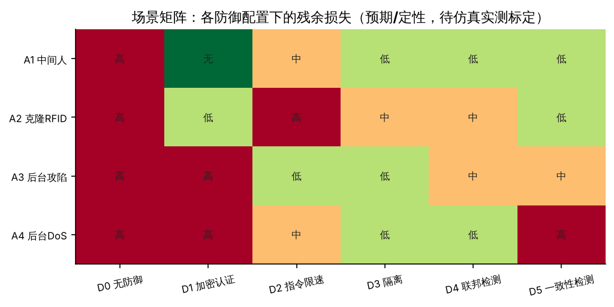{width=84%}

**图 16** OCPP 仿真实测：场景矩阵——各攻击变体 × 防御配置下被发现前的残余受控电量 ΔE（kWh，57 站真实会话；无遏制≈2,100、隔离后≈6–10）。

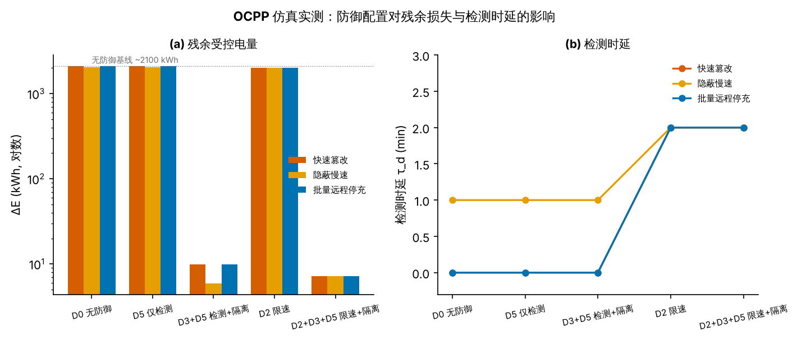{width=92%}

**图 17** OCPP 仿真实测：防御配置对残余损失与检测时延的影响。(a) 残余受控电量 ΔE（对数）；(b) 检测时延 τ_d。仅检测/限速不减损失，隔离降幅 >99%。

真实异常套件充当"闸门"：任一配置须在三类真实异常上将误报率控制在上限 α 内，否则不计入主比较。每个场景格重复运行，报告中位数与 95% 自助置信区间，全部种子与配置入库以保证可复现。

# 7 GIS 攻防可视化与工具链

## 7.1 攻防时间线的地图回放

可视化并非展示环节，而是"以被发现前损失为主指标"这一主张的直接承载：只有当损失能逐时、逐站点投影到真实地理底图上，"损失可上地图"才从修辞变为可核查的结果形式。图 18 由第 6 节的真实 OCPP 仿真逐站事件直接驱动（攻击者按站点繁忙度以 30 指令/分扇出，第 *k* 个被控站在 *k*/速率 分钟被控），把一次后台沦陷的攻防全过程在真实站点地理上回放：*t*₀ 入口单站被攻破，*t*≈0.6 min 指令沿地理扩散至约 19 站，无遏制时约 2 min 内全网 57 站被控（峰值受控≈0.89 MW）；而检测+隔离在约 1 min 内告警并按运营商隔离、恢复本地充电，被发现前残余受控电量从 2,115 kWh 降至 9.5 kWh。这些帧与第 6 节的 τ_d、τ_c 一一对应，使攻击扩散速度、检测时刻与遏制范围同时可见。配套的**交互式攻防指挥台**（暗色 SOC 界面，可切换防御配置、拖动时间轴、悬停查站点）在线回放同一真实仿真：https://claude.ai/artifact/HGTEGXjcdi4uarwkPWdoS9 。本文前述 GIS 图共同构成一套攻防图集：攻击面（图 3、4）、爆炸半径（图 8）、暴露（图 12）与时间线（图 18）。

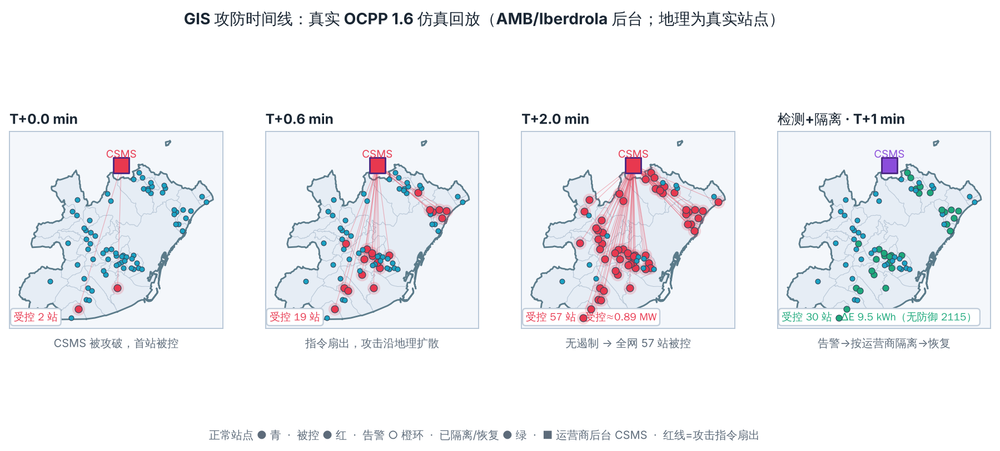{width=98%}

**图 18**（GIS）攻防时间线回放：由真实 OCPP 1.6 仿真逐站事件驱动（AMB/Iberdrola 后台，地理为真实站点）。红方块=被攻破的 CSMS，红线=攻击指令扇出，青=正常、红=被控、绿=已隔离/恢复。前三帧为无遏制扩散，末帧为检测+隔离的遏制结果（ΔE 9.5 vs 2,115 kWh）。

## 7.2 工具链

底图复用[11]已建成的 H3 分辨率 8（894 格、414 建成区）功能分区与 621 站点点图层；站点按运营商着色并连向各自 CSMS。仿真底座由开源组件拼装：每个充电桩由 Python `ocpp` 库[16]启一个异步客户端，回放真实会话或以"规模×节律"生成背景流量；CSMS 侧用 SteVe[17]（OCPP 1.6）或 CitrineOS[18]（OCPP 2.0.1），使协议版本成为可切换情景变量；拓扑由 Mininet/IPMininet[19]搭建，隔离边界与联邦节点显式建模；攻击由 mitmproxy 注入、流量特征由 NFStream 提取[20]。现成框架中 EmuOCPP[22]（基于 IPMininet）与本文需求最接近，可作全保真底座起点；本文第 6 节的实测即在此类平台的一个轻量实现上完成——用 `ocpp` 库[16]实现 CSMS 与 57 个充电桩客户端、真实 OCPP 1.6 消息经 websocket 交换（见附录 D）。异步 IO 使单机即可承载数十至数百个并发 OCPP 会话；情景变量均经配置文件参数化，支持场景矩阵批量重跑与地图回放的可复现归档。

# 8 讨论、伦理边界与结论

## 8.1 能与不能回答的问题

本文能回答：在既定拓扑与流量下，攻击者占据 OCPP 通道不同位置时实际可控的站点数、可控 MW、可被拒会话量，以及防御方从异常出现到定位遏制的时间。它不能回答电网物理层的稳定性——这超出现有数据。电网仅作结果指标且不建潮流模型的取舍由量级论证支持：63.47 MW 仅为本土峰值 0.16%，远低于触发 UFLS 的 9–11%（图 19）；[8]把攻击抽象为受控比例 *p* 却未回答 *p* 如何从网络层得到，本文补的正是这一空白。

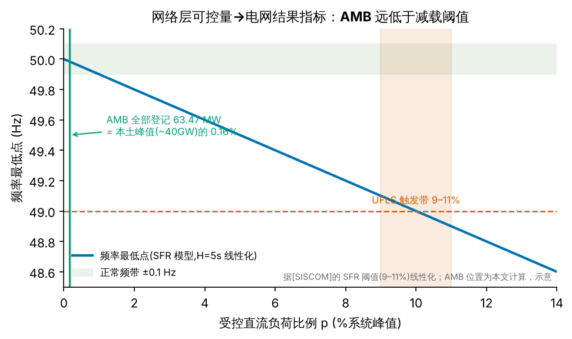{width=74%}

**图 19**网络层可控量→电网结果指标：AMB 全部登记 63.47 MW（0.16%）远低于 UFLS 触发带 9–11%。据[8]的 SFR 阈值线性化，AMB 位置为本文计算。

## 8.2 协议迁移与可迁移性

OCPP 版本直接决定可控性（图 6）：1.6 下中间人篡改、伪造电表与重放授权在未加密链路上现实可行；迁移到 2.0.1/2.1 后强制 TLS、设备证书与安全事件日志会显著压缩中间人与冒充类攻击面[12,13]，但后台被攻破后的批量限功率/停充、以及连接层 DoS 并不随协议升级消失（图 6 的 A3/A4 行）。本框架不绑定巴塞罗那：任何 AFIR 城市都有等价的国家接入点登记表底座，方法学可直接移植；但具体数值不可迁移——设施倍数（同站直流 3.45 倍）、认证构成（2,897/3,302 为 rfid;apps）、运营商口径（编号 37 / 名称 38）等须在当地重估。

## 8.3 伦理边界与局限

本研究全部在纯仿真环境进行，不接触任何真实运营商后台或充电桩，不向真实系统注入消息；任何在工具中发现的可被滥用缺陷遵循协调披露，并刻意不提供可直接用于攻击真实系统的操作细节、载荷或配置。主要局限：带会话流量的真实数据仅来自单一运营商（AMB 网络，Iberdrola Clientes）、单一年度，其余 550 站点只有静态属性、背景流量需借模型生成；DGT 登记表缺投运日期与配电拓扑；协议版本存在不确定性，只能以情景变量覆盖。

## 8.4 结论

（1）在巴塞罗那真实结构下，网络层 OCPP 攻防的关键量不是电网频率，而是可控站点、可控 MW 与被拒会话，电网只宜作结果指标；攻破单家后台可控 2.6–12.3 MW、约 5 家后台聚得全网八成直流功率、功率在运营商间高度集中（Gini 0.70），但均远低于触发 UFLS 的规模。（2）"规模×节律"分解可一物两用——既生成背景流量，又作站点上报电量的物理一致性检测器，并能把真实停电等良性异常与攻击区分。（3）链路加密只压制中间人与克隆类（A1/A2）、对后台攻陷与 DoS（A3/A4）无效，后二者须靠限速、隔离与检测遏制。（4）评价应以"被发现前造成的损失"为主指标，并全部可在 H3 底图上按时间轴回放。（5）真实 OCPP 1.6 仿真实测证实：隔离是遏制的决定性手段（残余受控电量降幅 >99%），而仅检测或仅限速几乎不减损失；规模×节律一致性检测器可捕获速率检测漏掉的隐蔽慢速攻击，且四次良性回放零误报。后续工作：接入站点动态可用性数据替代静态登记表假设，以其他 AFIR 城市数据及 2026 年新会话检验外部有效性，并将协议版本纳入情景扫描以量化迁移收益。

# 参考文献

[1] European Parliament and Council. Regulation (EU) 2023/1804 on the deployment of alternative fuels infrastructure (AFIR). *Off. J. Eur. Union* L234 (2023).
[2] European Commission. Commission Implementing Regulation (EU) 2025/655 (data availability for AFIR). (2025).
[3] Köhler, S. et al. Brokenwire: Wireless disruption of CCS electric vehicle charging. *NDSS* (2023).
[4] Szakály, M., Strohmeier, M., Martinovic, I. & Köhler, S. DCeption: Real-world wireless man-in-the-middle attacks against CCS EV charging. *arXiv:2601.15515* (2026).
[5] Szakály, M., Köhler, S. & Martinovic, I. Current Affairs: A security measurement study of CCS EV charging deployments. *USENIX Security* (2025).
[6] Open Charge Alliance. Open Charge Point Protocol 1.6 (2015).
[7] Open Charge Alliance. Open Charge Point Protocol 2.0.1 (2020).
[8] SISCOM 研究组（UPC）. 大规模入侵充电管理平台操纵直流充电桩对欧洲电网稳定性的影响：一项数据驱动的仿真评估（草稿，2026）.
[9] Buedi, E. D., Ghorbani, A. A., Dadkhah, S. & Ferreira, R. L. Enhancing EV charging station security using a multi-dimensional dataset: CICEVSE2024. *DBSec* (2024).
[10] Dalamagkas, C., Radoglou-Grammatikis, P. et al. Federated detection of OCPP 1.6 cyberattacks. *arXiv:2502.01569 / Complex Eng. Syst.* (2025).
[11] ［作者等］. 空间稀疏、时间完整：从单一运营商记录与开放城市数据推断充电需求（配套需求论文，v2.4，未刊稿）.
[12] Tridens Technology. OCPP protocols: 1.6, 2.0.1 and 2.1 (vendor overview).
[13] Codibly. OCPP 2.1 (IEC 63584): key features (vendor overview).
[14] Open Charge Alliance. OCPP 2.1 is now available; IEC 63584-210:2025 (2025).
[15] PowerBench Dataset – Part 3: Cyber attacks on EVCS. Zenodo 15401290 (UT Dallas, 2025).
[16] The Mobility House. `ocpp` — Python implementation of OCPP (open-source library).
[17] RWTH Aachen (ACS). SteVe — OCPP 1.6 charging station management system (open source).
[18] CitrineOS — open-source OCPP 2.0.1 CSMS.
[19] Mininet / IPMininet — network emulation.
[20] mitmproxy; NFStream — traffic interception and flow-feature extraction.
[21] Babayomi, O. & Kim, D.-S. Federated anomaly detection and mitigation for EV charging forecasting under cyberattacks. *arXiv:2511.17978* (2025).
[22] EmuOCPP: an OCPP-centric emulation testbed on IPMininet. *USENIX VehicleSec* (2025).

---

# 附录 A　正文数字核对表（来源与口径）

"复算"=本研究由原始文件重新计算；"[11]"=配套需求论文；"[8]"=SISCOM 仿真稿。

| 数字 | 值 | 来源/口径 |
|---|---|---|
| AMB 登记站点/充电点/接口 | 855 / 3,302 / 4,733 | DGT 登记表复算（electrolineras.xml, 2026-09-27, sha256 见 parse_report.json） |
| 运营商数 | 37（编号）/ 38（名称） | 复算（口径差异） |
| 总额定功率 / 直流 | 63.47 / 35.96 MW（直流 386 点，占功率 56.7%） | 复算（接口最大功率之和，额定非同时容量） |
| 直流功率分档 | <40:0.33；40–100:13.49；>100:22.14 MW | 复算 |
| 接受 RFID / rfid;apps | 3,053（92.5%）/ 2,897（87.7%） | 复算 |
| 单后台可控（前3） | Endesa 12.33 / Iberdrola 9.75 / BSM 8.67 MW | 复算 |
| 功率集中度 | 前 10 家后台≈80%；Gini 0.70 | 复算（图 9） |
| AMB 网络所属后台 | Iberdrola Clientes；71 站中 33 站在 DGT（98 点、3.74 MW） | features_report 复算 |
| 会话数 / 总电量 | 131,285 条清洗记录 / 1.97 GWh（直流会话 58.7%） | charging_records 复算（[11] 记 131,267） |
| 傍晚峰 / 占比 | 18 时为日均 2.02 倍；12–19 时占 45.4% | 复算 |
| 接口中位(时长/电量/功率) | Schuko 114min/3.3/2.2；Type2 55/5.8/7.2；DC40-100 28/18.2/48.3；DC>100 27/26.9/85.8 | 复算（图 14） |
| 各接口年增长 | DC 1.67×、Type2 1.25×、Schuko 0.77× | site_month 复算（图 15） |
| 4-28 大停电 | 146 次 vs 邻周 285.8（比 0.51；一致性比 0.53） | 复算（图 13） |
| 全年增长 | 1 月 9,578→12 月 14,330 次（1.5 倍） | 复算 |
| 网络平均/峰值功率 | 0.225 / 0.399 MW（小时平均） | 复算（能量/8760h=0.225 自洽） |
| 满桩 | Q4 16 个站点单元≥5%，14 个站点 | 复算（与[11]一致） |
| 规模×节律解释力 / 同站直流倍数 | 64%/68%/83%；3.45 倍 | [11] |
| SISCOM | p≈0.8%(2024)、2035≈6.7%、UFLS 9–11%、2.5 MW→<0.90 pu、限速 40%→4%→~0% | [8] 原文复核 |
| 本土电网峰值 / AMB 占比 | ~40 GW / 0.16% | [8] 参照；63.47/40000 计算（图 19） |
| 巴塞罗那 OCPP 版本 | 1.6（Endolla 计划 2.0） | **未查得出处，按情景假设处理，非前提** |

# 附录 B　完整场景矩阵

- **攻击者位置 A**：A1 桩-后台中间人（明文/可降级链路）；A2 冒充桩与克隆 RFID、重放授权；A3 后台被攻破、批量下发限功率/停充；A4 连接/心跳洪泛 DoS。
- **OCPP 版本与安全配置 V**：V1 OCPP 1.6（TLS 可选、无消息级认证）；V2 OCPP 2.0.1 安全配置档 1/2/3；V3 OCPP 2.1（含 IEC 63584-210:2025，Plug&Charge）。
- **防御配置 D**：D0 无防御；D1 链路加密与双向认证；D2 远程功率/停充指令限速；D3 按运营商/区域隔离；D4 跨运营商联邦检测；D5 规模×节律物理一致性检测。单独与组合取值。
- **攻击规模与协同度 C**：受控集合（单站/单运营商/跨运营商）×目标选择（随机/择直流高功率）×协同度（独立随机启动/时间同步）。受控功率上限 = 登记表额定功率在受控集合上的求和（全网 63.47 MW、直流 35.96 MW 为天花板）。

# 附录 C　指标形式化定义

设攻击在 *t*₀ 注入首条恶意 OCPP 消息，*t_d* 为首个可归因真阳性告警，*t_c* 为遏制使受控功率/会话降至阈值 ε 以下。
检测时延 τ_d=*t_d*−*t*₀；遏制时间 τ_c=*t_c*−*t_d*；端到端 TTC=*t_c*−*t*₀。
被操纵电量 ΔE=Σ_会话|*P*_操纵−*P*_标称|·Δt（MWh）；被拒会话 N_rej=基线计划中因攻击未开始或被强制中止的会话数；受影响市镇 |M_aff|=含≥1 个受控站点的市镇集基数。
计费偏差 Δ€=Σ_会话|*E*_上报−*E*_真实|·电价；偷电量=未授权交付 kWh。误报率 FPR=FP/(FP+TN)，按时间窗与消息两种口径分别统计。各指标报告跨重复运行的中位数与 95% 自助置信区间。

# 附录 D　OCPP 仿真平台、实测口径与负荷重建

**可达性模型（图 6）：** 可达充电点/MW 为上界，按（位置,配置）给定——A1 仅达未加密链路、A2 达接受 RFID 的点（2.1 P&C 下降至约 10%）、A3/A4 达目标运营商整支机队且与链路配置无关。

**OCPP 仿真平台（图 16、17、A1 的来源）：** 用 Python `ocpp` 库[16]实现真实 OCPP 1.6-J 消息，57 个充电桩异步客户端经真实 websocket 连至一个 CSMS，按 2025-12-05（最繁忙工作日，窗口 16–22 时，254 笔真实会话）回放。离散虚拟时钟 1 分钟步进、与墙钟解耦，故每条消息的处理延迟不污染仿真时间。攻击 = A3 后台沦陷：t₀ 起向站点（按日负荷降序）扇出 SetChargingProfile(limit=0) 或 RemoteStopTransaction，速率为快速 30/慢速 3 指令/分；限速防御把 CSMS 外发控制指令上限设为 2/分。检测器并用指令速率与规模×节律功率一致性（预期 = 无攻击调度功率，观测由桩上报 MeterValues 聚合）。指标：τ_d=首个真阳性告警−t₀；残余受控电量 ΔE=受控区间∩会话活动区间内被curtail功率的积分；被拒会话、受控站点、峰值受控功率；误报率由无攻击回放统计。每格三次重复取中位数。实测 D0 峰值受控功率 0.886 MW，与独立负荷重建（图 A2，峰值≈0.40 MW 小时均、瞬时并发更高）量级一致。

**电网对照（图 19）：** 频率最低点按 SFR 模型线性化（nadir=50−10*p*，*p*=10% 时达 49.0 Hz UFLS），UFLS 带 9–11% 据[8]；AMB 位置 *p*=63.47 MW/40 GW=0.16% 为本文计算。

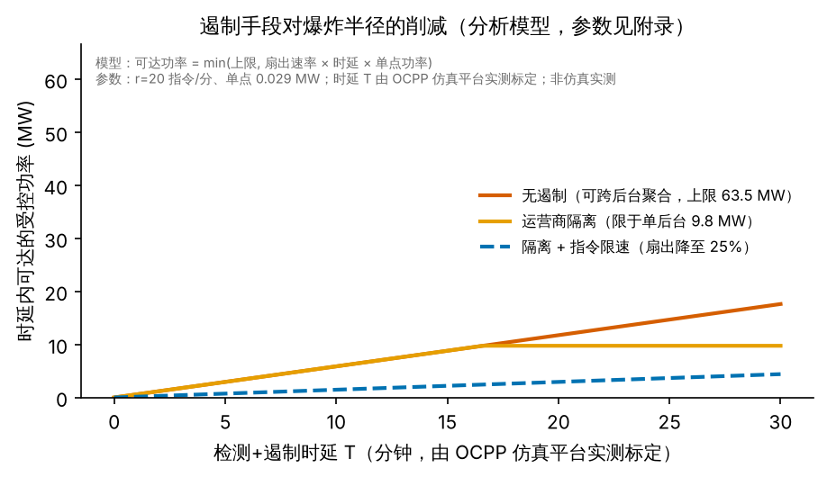{width=72%}

**图 A1** OCPP 仿真实测：受控功率随时间（快速篡改攻击）。D0/仅检测爬升至≈0.89 MW 不降；检测+隔离约 1 分钟归零；限速+隔离峰值≈0.23 MW。

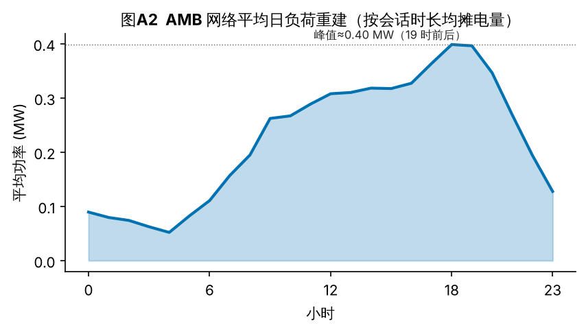{width=62%}

**图 A2** AMB 网络平均日负荷重建（按会话时长均摊电量）：平均约 0.22 MW、峰值约 0.40 MW。

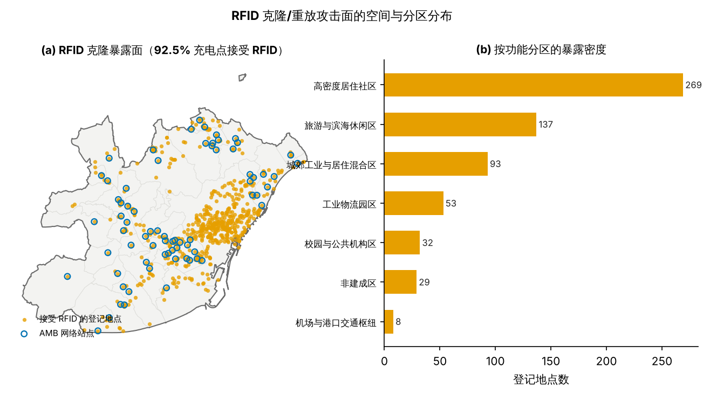{width=94%}

**图 A3**（GIS）RFID 克隆/重放攻击面的空间与分区分布：92.5% 充电点接受 RFID；(a) 空间分布，(b) 按功能分区的暴露密度。

# 附录 E　相关安全数据集定位详表

| 数据集 | 内容 | 层级 | 相对本文的缺口 |
|---|---|---|---|
| CICEVSE2024[9] | 功耗+网络+主机 HPC/内核；侦察/DoS/后门/挖矿 | 桩设备（实验室） | 通用攻击非 OCPP 消息级；脚本流量 |
| 联邦 OCPP 1.6[10] | OCPP 应用层四类攻击 PCAP+CSV | OCPP 后端（实验室） | 流量脚本生成、无真实节律与拓扑 |
| Current Affairs[5] | 325 台真实直流桩，约 12% TLS | 车↔桩链路 | 测车-桩接口而非 OCPP 后端 |
| DCeption/Brokenwire[4,3] | CCS HPGP 无线中间人、功率遥测篡改 | 车↔桩物理层 | 不触及 CSMS 侧 OCPP 会话 |
| PowerBench Part 3[15] | OpenDSS 电网仿真、EVCS 攻击 | 配电物理层 | 非网络/协议数据 |
| **本文** | 真实运营商结构+真实会话+OCPP 攻防仿真 | OCPP 后端控制通道（网络层） | —（填补交集） |
