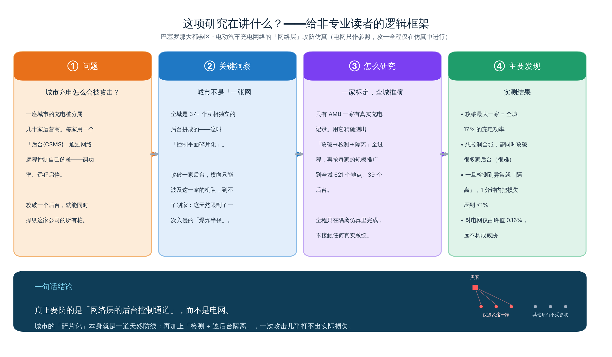
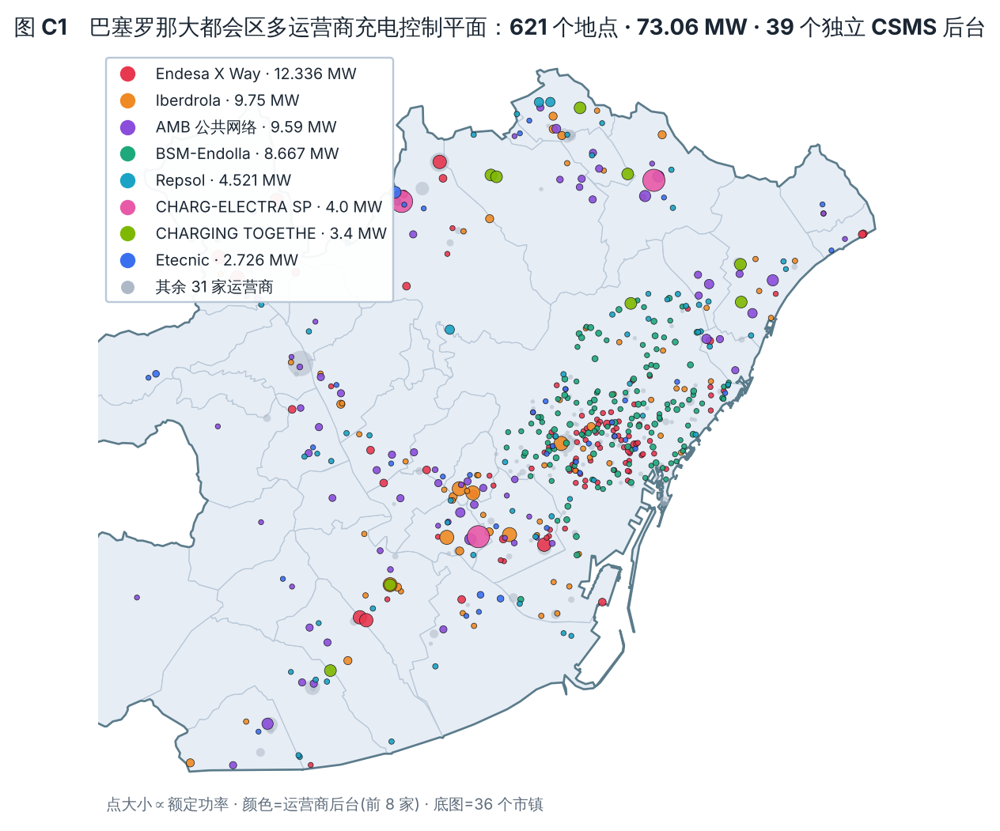
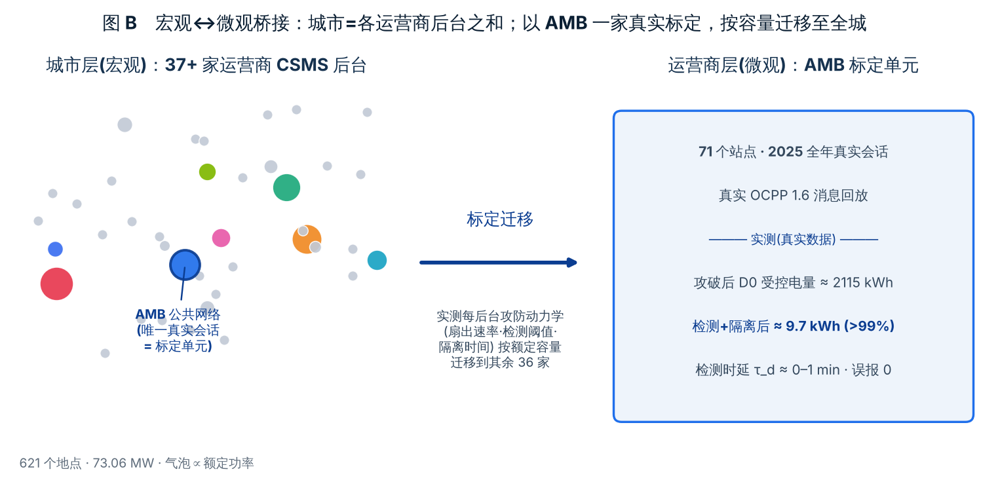
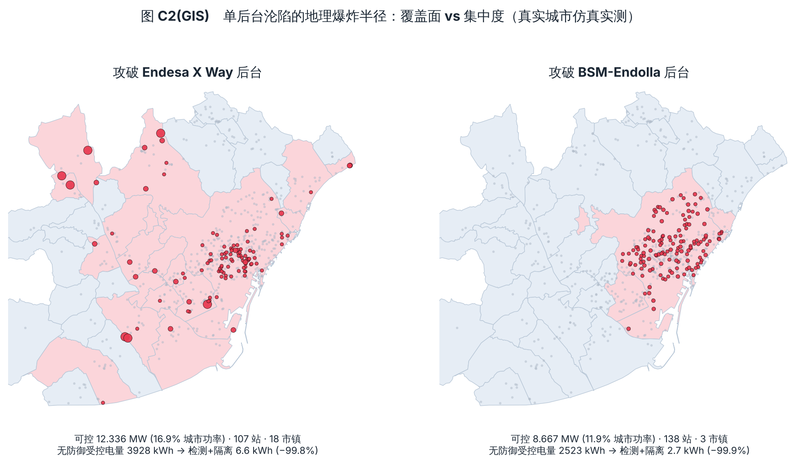
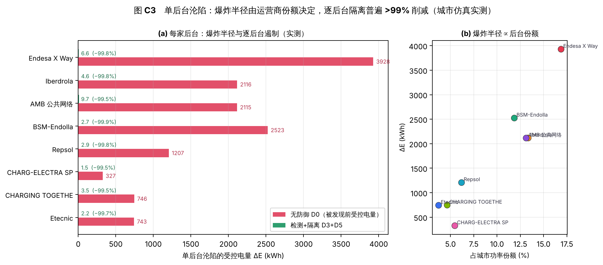
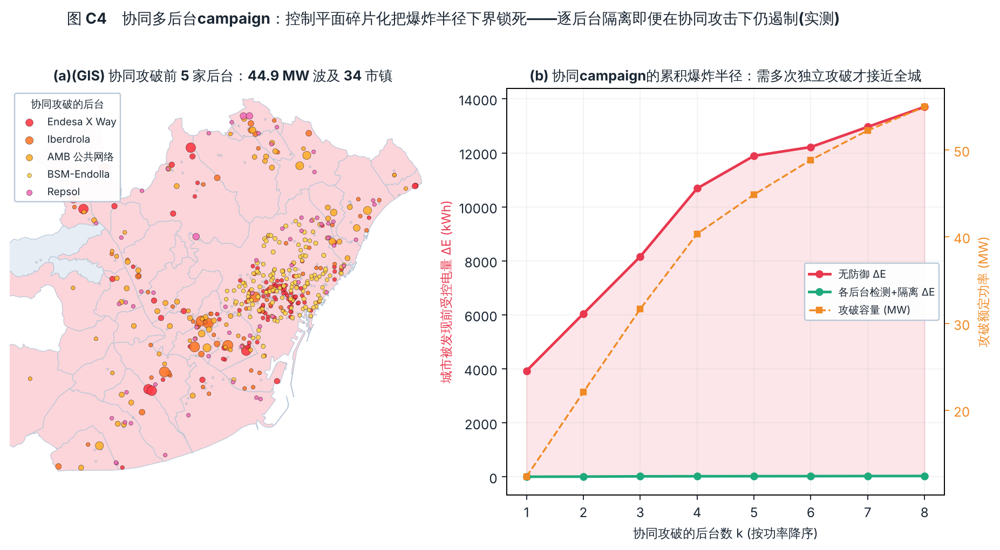
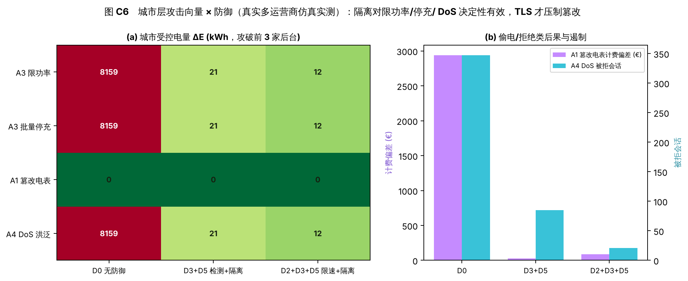
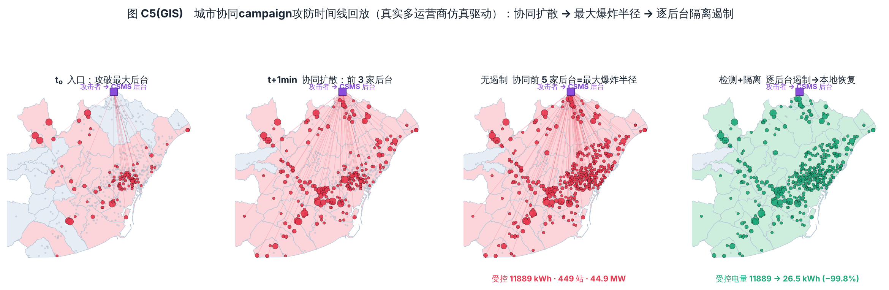

# 摘要

一座城市的公共充电不是"一张网"，而是由数十家运营商各自的 OCPP 控制通道汇聚成的**碎片化控制平面**：每家充电桩与其运营商后台（CSMS）之间的控制通道都可能被集中操纵，而不同后台之间彼此隔离。已有研究要么在电网尺度把攻击抽象成一个"受控比例 *p*"，却不回答 *p* 如何从网络层得到；要么用实验室脚本流量训练入侵检测，与真实城市充电的多运营商结构、站点规模和日节律相去甚远。本文以巴塞罗那大都会区（AMB）真实的多运营商结构与真实充电流量为底座，提出一个**全部集中在网络层**、覆盖**整座城市**的 OCPP 攻防仿真框架，并用一个清晰的**宏观↔微观两层方法**消解"多家与一家混杂"的分析困境：**宏观层**把全城建模为 621 个登记地点、约 73 MW、**37 家以上相互独立的 CSMS 后台**（DGT 登记表 37 家/63.47 MW，另加以真实会话标定的 AMB 公共网络），在真实城市地理上实测"一次后台沦陷能横向扩散到多少站点、多少 MW、多少市镇"；**微观层**以唯一拥有真实会话的 **AMB 公共网络（71 站）为标定单元**，用真实 OCPP 1.6 消息回放实测单后台的攻防动力学（扇出速率、检测阈值、隔离时间），再按登记容量迁移到其余 36 家后台。电网只作结果指标，不建潮流模型。真实城市仿真实测给出三点新结论：其一，**控制平面碎片化锁死了爆炸半径下界**——攻破单家后台只可控 2.6–12.3 MW（最大一家 Endesa 占全城 16.9%），逐后台隔离普遍把被发现前受控电量从数千 kWh 压到 10 kWh 以内（>99%）；其二，即便**协同攻破功率前 5 家后台**（44.9 MW、波及 449 站/34 市镇），也需 5 次相互独立的后台攻陷，且各后台本地隔离仍把全城受控电量从 11,889 kWh 压到 26.5 kWh；其三，**覆盖面与集中度解耦**——Endesa 一家波及 18 个市镇，而功率相当的 BSM-Endolla 集中在市中心 3 个市镇。微观标定单元与宏观实测在物理上自洽（AMB 后台无防御受控电量 2,115 kWh，与宏观一致）。防御侧，"规模×节律"一致性检测器可把 2025-04-28 大停电（全网同步降至期望 0.53）与单站伪造电表读数区分；链路加密只压制中间人与克隆类（A1/A2），对后台攻陷与 DoS（A3/A4）无效。全文以"被发现前造成的损失"（MWh、被拒会话、受影响市镇）为主评价指标，并以 1 幅面向非专业读者的全文逻辑框架图加 26 幅融合图（含 9 幅 GIS 攻防可视化，其中 4 幅为城市级多运营商）与一个交互式三维指挥台在真实地图上回放攻防全过程。全部图表采用浅色高对比配色以便直观观测。

**关键词：** 电动汽车充电；OCPP；CSMS；控制平面碎片化；城市级网络层攻防仿真；多运营商；GIS 可视化；入侵检测；关键基础设施安全；巴塞罗那

{width=96%}

**图 0** 全文逻辑框架（面向非专业读者）：问题（运营商后台远程控制充电桩）→ 关键洞察（城市控制平面碎片化）→ 方法（一家真实标定、全城推演，全程仿真）→ 主要发现（单后台 17%、协同难、检测+隔离 <1%、电网 0.16%）→ 结论（该防网络层后台通道，碎片化+检测隔离使攻击几乎无损）。

# 1 引言

公共充电网络正在欧盟城市快速扩建。《替代燃料基础设施法规》（AFIR）要求运营商经各成员国的国家接入点公开充电点的静态与动态信息[1]，其实施条例进一步细化了数据可用性口径[2]；但真实充电会话通常不在公开之列，面向真实流量的充电网络安全研究因此长期缺乏底座。与此同时，针对充电接口物理层与无线层的攻击已被反复证实[3,4,5]，但这些工作大多止步于单桩或单链路，难以回答"在一座城市的真实充电网络里，一次入侵能横向扩散到多大范围"。

本文把研究单位收敛到充电桩（EVSE）与运营商后台（CSMS）之间的 OCPP 控制通道[6,7]，并把问题放到**整座城市**的尺度。关键观察是：一座城市的充电控制平面并非一张统一的网，而是由**数十家运营商各自独立的 CSMS 后台**拼成的碎片化结构——攻击者攻破一家后台，其横向可达范围被该运营商的机队边界所限，无法越界到另一家。这把"攻击者处在通道哪个位置、能波及多少站点"从单桩问题升格为**城市拓扑问题**：全城的韧性取决于控制平面的碎片化程度与各后台的安全态势。相较物理层，网络层攻防也更贴近运营商当前真实可部署的检测与遏制手段。

现有工作留下两处空白。其一，电网尺度研究通常把攻击抽象成一个"受控比例 *p*"：配套仿真研究[8]给出 2024 年欧洲大陆尺度 *p*≈0.8%，需升至约 9–11% 才触发低频减载（UFLS），却不回答 *p* 如何从网络层、在多运营商结构下获得。其二，用于训练入侵检测的数据集多依赖实验室脚本流量[9,10]，缺乏真实城市充电的多运营商规模差异与日节律。本文不以"操纵电网"为主线：据 DGT 国家接入点登记表复算，AMB 范围 37 家运营商、3,302 个充电点合计额定功率仅 63.47 MW，即便完全控制，相对西班牙本土约 40 GW 峰值也仅 0.16%，在系统频率层面不成立（图 16），与[8]一致。因此电网仅作结果指标，不建潮流模型。

**研究问题：** 在巴塞罗那真实的多运营商结构与真实充电流量下，攻击者攻破一家或协同攻破多家 CSMS 后台时，实际能控制多少站点、多少 MW、拒绝多少会话、波及多少市镇；防御方又能多快发现并逐后台遏制？**贡献：**（1）以真实多运营商拓扑与真实流量为底座、覆盖整座城市的网络层 OCPP 攻防**实测**仿真（621 地点/39 后台）；（2）一个清晰的**宏观↔微观两层方法**——以唯一有真实会话的一家运营商标定单后台攻防动力学，再按登记容量迁移到全城，从方法上消解"多家与一家混杂"；（3）把"规模×节律"分解一物两用（背景流量生成器 + 物理一致性检测器）；（4）以"被发现前造成的损失"为主评价指标，并以 24 幅融合图（含 7 幅城市级 GIS 攻防可视化与交互式三维指挥台）在真实地图上回放。第 2 节数据与协议背景，第 3 节威胁模型、仿真底座与宏观/微观方法，第 4 节攻击面与可控性上限，第 5 节检测与遏制，第 6 节微观标定与宏观城市实测，第 7 节 GIS 可视化与工具链，第 8 节讨论与结论。

{width=82%}

**图 1**（GIS）巴塞罗那大都会区多运营商充电控制平面：621 个登记地点、约 73 MW、39 个相互独立的 CSMS 后台。点大小∝额定功率、颜色为前 8 家运营商后台；BSM-Endolla（绿）密集于市中心，Endesa/Iberdrola 覆盖面更广。底图为 36 个市镇。

# 2 相关工作与数据基础

## 2.1 OCPP 协议与安全

OCPP 是 EVSE 与 CSMS 之间事实上的标准控制协议，其版本差异直接决定网络层攻防的门槛。OCPP 1.6 提供 SOAP/JSON 绑定，传输层加密为可选、设备认证较弱；虽有官方安全扩展定义三级安全配置，但是否启用取决于部署而非协议强制[6,12,13]。OCPP 2.0.1 引入证书认证、结构化安全配置档并强制 TLS[7,12]。OCPP 2.1（IEC 63584-210:2025）面向 V2X/DER 的双向能量交互并新增授权与支付机制[14]；1.6 与 2.1 消息模型不兼容。对本文最关键的是：1.6 报文的可篡改性与缺乏计量完整性约束，使"协同功率操纵"在协议层几乎没有门槛。因此本文把协议版本与安全配置作为情景变量纳入仿真矩阵。"巴塞罗那现网以 OCPP 1.6 运行、Endolla Barcelona 计划升级至 2.0"一说本文未查得权威出处，仅作情景假设，非前提。

## 2.2 相关安全数据集的定位

现有公开数据集均未覆盖"真实多运营商结构 + 真实充电流量 + OCPP 消息级攻防"这一交集：**CICEVSE2024** 含功耗、网络与主机指标，但攻击为实验室脚本且非 OCPP 消息级[9]；**联邦 OCPP 1.6 数据集**聚焦 OCPP 应用层四类攻击，但流量同样出自实验室脚本[10]；**Current Affairs（CCS 测量）**实测 325 台真实直流桩、约 12% 启用 TLS，但对象是车↔桩链路[5]；**DCeption/Brokenwire** 针对 CCS HPGP 的无线中间人与功率遥测篡改，停留在车↔桩物理层[4,3]；**PowerBench Part 3** 为 OpenDSS 电网仿真数据，属配电物理层[15]。本文定位正是补上该交集（详表见附录 E）。

## 2.3 城市仿真底座与"多家/一家"的口径

配套需求论文[11]及其派生图层为本文提供真实底座。**宏观底座（多家）**：由 DGT DATEX II 登记表（2026-09-27 快照）复算得 855 条站点记录、3,302 个充电点、4,733 个接口、**37 家运营商**（按编号；按名称 38 家）、合计额定功率 **63.47 MW**（直流 35.96 MW）；按同一运营商 50 m 内合并为 621 个登记地点，覆盖 36 个市镇。**微观标定底座（一家）**：71 个 AMB 公共网络站点有 2025 全年清洗会话（131,285 条清洗记录、总电量 1.97 GWh），是**唯一**拥有真实会话的运营商网络；其中 33 站登记在 DGT 中、运营商为 Iberdrola Clientes（其余 38 站不在 DGT，故 AMB 网络容量多在登记表之外）。两者合并即城市仿真底座：**621 个地点、约 73 MW、39 个后台标识**（63.47 MW 登记 + 9.59 MW 以真实会话标定的 AMB 网络）。**可复用模型**："规模×节律"分解在本文一物两用（第 3、5 节）：仅站点规模即解释约 64% 会话偏差、73% 电量偏差，加节律与设施状态升至约 68%，上限约 83%。真实数据中的若干异常（4-28 大停电、11-30 与 12-11 全网缺口）为检测器提供了实验室流量所不具备的"假阳性"考验。

# 3 威胁模型、仿真底座与宏观/微观方法

全部攻击仅在隔离仿真环境内复现，不接触任何真实充电桩、运营商后台或配电系统。

## 3.1 系统与节点模型：碎片化的控制平面

仿真拓扑含 621 个地点，归属 39 个运营商后台标识；**每家运营商各自接入其独立的 CSMS**，EVSE 与 CSMS 之间以 OCPP over WebSocket 承载控制通道[6,7]。这一点是全文的结构性前提：控制平面不是一张网，而是 39 个相互隔离的控制域——攻击者攻破后台 *o* 只能向 *o* 的机队扇出指令，无法越界。电网仅作结果指标，不建潮流或频率模型；受控功率上限因而可由登记表额定功率静态推算，作为"完全控制"情形的上界（第 4 节）。

## 3.2 宏观↔微观两层方法（本文的组织主线）

真实数据的约束是：**只有 AMB 一家有真实会话，其余 36 家只有静态登记属性**。若把两者混为一谈，分析必然"多家与一家"相互缠绕。本文因此显式分为两层，并给出其桥接（图 3）：

- **微观层（一家·标定单元）：** 以 AMB 公共网络（71 站、真实会话）为唯一高保真单元，用真实 OCPP 1.6 消息回放**实测**单个后台被攻破后的攻防动力学——攻击扇出速率、检测时延、隔离时间、残余损失与误报（第 6.1 节）。这是全文唯一"用真实数据测出来"的一格。
- **宏观层（多家·全城系统）：** 把全城视作 39 个控制域之和。微观测得的**每后台动力学**按各运营商的 DGT 登记容量与功能分区节律迁移到其余 36 家（其需求用"规模×节律"合成：scale = 该地点 DGT 额定功率，节律 ρ 取自 AMB 实测的同类功能区利用率），从而在整座城市上**实测**单后台沦陷、协同多后台 campaign 的爆炸半径与遏制（第 6.2 节）。
- **桥接（关系）：** 城市结果 = 各后台"单元"在碎片化拓扑上的组合；"一家"是测量单位，"整座城市"是被测系统。二者并非两套相互竞争的分析，而是同一模型的微观与宏观。合成需求的不确定性随攻防指标一并报告；以其他运营商拟合的部署模型给 AMB 打分 AUC 仅 0.26[11]，故合成流量仅作容量定标的可信负荷占位。

{width=96%}

**图 3** 宏观↔微观桥接：城市 = 各运营商后台之和；以 AMB 一家真实会话标定单后台攻防动力学（实测 D0 受控电量≈2,115 kWh、隔离后≈9.7 kWh、τ_d≈0–1 min、误报 0），再按登记容量迁移至全城其余 36 家后台。

## 3.3 威胁模型与真实异常考验

攻击者能力随链路配置变化（图 2）。在未加密或未互认的 OCPP/WebSocket 链路上，赋予攻击者 Dolev–Yao 式能力；随 TLS、客户端证书或双向认证启用，该能力收缩为仅可观察时序或仅可发起连接层洪泛[6,7,12,13]。信任假设：EVSE 固件完整；CSMS 为合法策略权威但本身可被攻破并用作攻击位置。攻击者目标归为功率操纵、偷电、拒绝/可用性破坏三类。本文保留若干"貌似攻击的真实异常"用作假阳性考验（附录图）：2025-04-28 伊比利亚大停电当日会话约为平常一半（146 vs 邻周 285.8，比值 0.51），形态近似协同停充；1–2 月后台迁移导致充电点编号批量更换，近似身份克隆；11-30 与 12-11 全网零记录缺口，近似连接中断。检测器必须将其判为良性。

{width=80%}

**图 2** 威胁模型：OCPP 控制通道上的四类攻击者位置。A 中间人、B 冒充桩/克隆 RFID、C 后台被攻破、D 对后台 DoS；电网仅作结果指标（虚线）。

# 4 攻击面与可控性上限（静态天花板）

本节给出**静态上限**，作为第 6 节实测的对照天花板。

**表 1** 四类攻击者位置的 OCPP 层机制与结果指标。

| 攻击者位置 | OCPP 层机制 | 结果指标 |
|---|---|---|
| A 桩-后台中间人（未加密链路） | 篡改 SetChargingProfile 功率上限、改写 MeterValues、伪造/截停 RemoteStopTransaction | 被改功率站点数、计费偏差（€） |
| B 冒充桩/克隆 RFID | 伪造 BootNotification 注册、重放 Authorize | 偷电量（kWh）、虚假占用 |
| C 后台（CSMS）被攻破 | 单点向本后台大量桩扇出 SetChargingProfile 限功率或 RemoteStop | 可控 MW、被拒会话数、受影响市镇数 |
| D 对后台拒绝服务 | Heartbeat 或 WebSocket 连接洪泛 | 失联站点数、离线期间会话数 |

设攻击者位置 *a*、安全配置 *c*，可达集 *R*(*a*,*c*) 为该位置、配置下可影响的充电点集合；在其上定义受控站点数、可控 MW *P*=Σ*P*~rated~、被拒会话数、受影响市镇数与计费偏差。可控 MW 的上限由登记表给定（图 4）：全体 ≤ 63.47 MW、直流 ≤ 35.96 MW（直流占 56.7%）；按功率降序攻破约 5 家后台即达全网约八成直流功率。认证侧，3,053 个充电点（92.5%）接受 RFID、2,897 个（87.7%）为"rfid;apps"组合，使 B 类克隆现实可行。可达性是"位置×配置"的函数（图 5）：链路加密（wss/TLS、双向证书）可把中间人（A1）可达功率从上限压到 0、把 RFID 克隆（A2）在 2.1 Plug&Charge 下由 3,053 点压到约 305 点；但**后台被攻破（A3）与连接层 DoS（A4）不依赖链路机密性，无论协议版本都可达目标运营商整支机队**。这把[8]抽象的"受控比例 *p*"翻译成了"需攻破几家后台、以何种配置、可达多少 MW"的网络层问题。可控功率在运营商间高度集中（图 6，Gini 0.70）：前 10 家后台即聚合约 80% 额定功率，意味着少数后台的安全态势决定全网可操纵规模。须强调可控 MW 是**上限/恒等式**意义的量，并非电网后果（图 16）。

{width=90%}

**图 4** 攻击面的静态上限（DGT 登记表）。(a) 认证可达面：3,053 点接受 RFID；(b) 后台聚合的可控功率：约 5 家后台即达全网八成直流功率，全网上限 63.47 MW。

{width=90%}

**图 5** 可达性上界模型：攻击者位置 × OCPP 安全配置。加密压制 A1/A2，但对 A3（后台攻陷）与 A4（DoS）无效。

{width=88%}

**图 6** 可控功率的运营商集中度。(a) 前 10 家后台≈80% 功率；(b) 洛伦兹曲线，Gini 0.70。

# 5 防御：检测与遏制

与攻击侧一致，全部检测与遏制逻辑置于网络层与 CSMS，**按运营商后台（控制域）分别部署**，电网量仅作结果指标。

检测融合两路特征：传输层流量特征（包/字节速率、到达间隔、连接频繁建断、心跳节律）识别 DoS 洪泛与中间人痕迹；OCPP 消息层特征（消息类型序列、远程控制指令下发节律、授权/重放模式与 MeterValues 内部一致性）识别后台攻陷[20]。核心检测器把"规模×节律"分解转为**物理一致性检验**：后台 *o* 在时片 *t* 的期望功率 *Ê*(*o*,*t*)=Σ~s∈o~ scale*~s~*·ρ~zone(s)~(*t*)；以观测/期望比 *r*=*P*~obs~/*Ê* 为判据，低于下带（限功率/停充/DoS）或高于上带（伪造电表读数）即告警。图 7（下）在真实日序列上展示其行为——4-28 大停电使**全网同步**降至期望的 0.53（全站一致→判为良性、须白名单），而注入的伪造电表读数在**单站**使比值冲高越过上带（告警）；二者的区分正来自"规模×节律"的联合期望。遏制手段建模为情景变量：远程功率/停充指令限速（据[8]有效）、按运营商或区域隔离、跨运营商联邦检测[10,21]。主指标为"被发现前造成的损失"：累计受控电量（MWh）、被拒会话数、受影响市镇数；检测时延 τ_d=首个真阳性告警−攻击注入，损失即检测时延沿攻击功率曲线的积分。

{width=88%}

**图 7** 物理一致性检测器在真实日序列上的行为。上：全网日会话数与"规模×节律"28 日稳健基线（1 月 9,578→12 月 14,330 次）；下：观测/期望一致性比，4-28 大停电全网同步跌至 0.53（良性）、注入的伪造电表读数单站冲高越过上带（告警）。

# 6 微观标定与宏观城市实测

本节在真实 OCPP 1.6 仿真平台上实测：真实会话经真实 OCPP 消息回放，攻击与检测/遏制在隔离环境中实际运行（平台见 6.3 节、附录 D）。严格按 3.2 节两层组织：**6.1 微观标定一家，6.2 宏观实测全城**。

## 6.1 微观层：AMB 标定单元（一家，真实会话）

对唯一有真实会话的 AMB 公共网络（代表日 2025-12-05 傍晚 16–22 时、57 个有会话站点、每格 3 次重复），实测单后台攻防动力学（图 8、图 9）。三点结论：其一，**检测必须配合遏制**——仅检测（D5）与无防御（D0）的被发现前残余受控电量同为约 2,115 kWh，而叠加隔离（D3+D5）降至约 6–10 kWh（降幅 >99%）。其二，**规模×节律一致性检测器**捕获了指令速率检测漏掉的隐蔽慢速攻击（3 指令/分），约 1 分钟内告警；快速攻击由速率检测在 0–1 分钟内捕获。其三，单用限速（D2）而不隔离几乎不减损失（攻击仍最终波及全部 57 站），限速叠加隔离把爆炸半径压到约 6 站、峰值受控功率从约 0.89 MW 降到约 0.23 MW；A1 篡改电表无功率损失但产生约 €761 计费偏差。四次良性回放误报为 0。**这组实测即标定了"单个后台被攻破并遏制"的动力学参数，供 6.2 节迁移到全城。**

{width=82%}

**图 8** 微观标定（AMB 一家，真实会话）：场景矩阵——各攻击变体 × 防御配置下被发现前的残余受控电量 ΔE（kWh；无遏制≈2,115、隔离后≈6–10）。

{width=90%}

**图 9** 微观标定（AMB 一家）：防御配置对残余损失与检测时延的影响。(a) 残余受控电量 ΔE（对数）；(b) 检测时延 τ_d。仅检测/限速不减损失，隔离降幅 >99%。

## 6.2 宏观层：全城多运营商实测（多家）

把 6.1 标定的每后台动力学迁移到全城 39 个后台，在真实城市地理上实测（攻击傍晚 18 时注入、快速攻击 30 指令/分，每后台独立检测+隔离）。

**单后台沦陷（图 10、图 11）：** 攻破单家后台的爆炸半径由该运营商份额决定——Endesa 可控 12.33 MW（占全城 16.9%、波及 18 市镇）、Iberdrola 9.75 MW、AMB 9.59 MW、BSM 8.67 MW（但集中在市中心 3 市镇），单后台可控区间 2.6–12.3 MW。无防御下被发现前受控电量 1,207–3,928 kWh，而**逐后台检测+隔离普遍将其压到 10 kWh 以内（>99%）**。碎片化在此直接体现为爆炸半径的硬上界：没有任何单次后台攻陷能触及全城两成以上功率。覆盖面与集中度解耦（图 10）：Endesa 一家横跨 18 市镇，功率相当的 BSM 仅 3 市镇——前者利于广域协同降功率，后者利于局地高密度打击。

{width=98%}

**图 10**（GIS）单后台沦陷的地理爆炸半径（真实城市仿真实测）：攻破 Endesa（12.33 MW，18 市镇，覆盖面广）vs 攻破 BSM-Endolla（8.67 MW，3 市镇，市中心集中）；均经检测+隔离后 >99% 削减。

{width=98%}

**图 11** 单后台沦陷实测（前 8 家后台）：(a) 爆炸半径（无防御 ΔE）与逐后台遏制（隔离后 ΔE，普遍 >99% 削减）；(b) 爆炸半径∝后台份额。

**协同多后台 campaign（图 12）：** 若攻击者同时攻破功率前 *k* 家后台，受控电量随 *k* 累积：*k*=3（31.7 MW）无防御 8,159 kWh/249 站、*k*=5（44.9 MW）11,889 kWh/449 站/34 市镇、*k*=8（55.0 MW）13,705 kWh/501 站。但碎片化锁死了下界——接近全城需 *k* 次**相互独立**的后台攻陷（而非一次），且**各后台本地隔离即便在协同攻击下仍逐一遏制**：*k*=5 时全城受控电量从 11,889 kWh 压到 26.5 kWh、*k*=8 时压到 33.7 kWh。碎片化既是攻击者的横向障碍，也是防御方的天然隔舱。

{width=98%}

**图 12** 协同多后台 campaign（实测）：(a)(GIS) 协同攻破前 5 家后台=44.9 MW 波及 34 市镇；(b) 累积爆炸半径随 *k* 上升，但各后台检测+隔离把全城 ΔE 压在 34 kWh 以内。

**城市层攻击向量 × 防御（图 13）：** 攻破前 3 家后台（31.7 MW）下，四类向量的城市后果与遏制：限功率/批量停充/DoS 的无防御受控电量同为 8,159 kWh，检测+隔离降至 20.9 kWh、限速+隔离 11.7 kWh；A1 篡改电表无功率损失但累计计费偏差 €2,937，检测+隔离降至 €26.7。一个值得注意的细节：对**隐蔽篡改**，限速反而把计费偏差从 €26.7 抬到 €88.2——因为后台聚合的一致性检测需要受篡改站点达到临界比例才告警，限速使篡改扩散变慢、聚合异常累积更慢、检测更晚（单站级一致性检测可规避此弊，见 6.1 微观）。这说明遏制手段须与攻击向量匹配：隔离对限功率/停充/DoS 决定性有效，而唯有 TLS/消息完整性才压制篡改。

{width=96%}

**图 13** 城市层攻击向量 × 防御（真实多运营商仿真实测，攻破前 3 家后台）：(a) 受控电量 ΔE 热力图；(b) 篡改计费偏差与 DoS 被拒会话。

**6.3 仿真平台。** 平台用 Python `ocpp` 库[16]实现真实 OCPP 1.6-J 消息（BootNotification/Authorize/StartTransaction/MeterValues/StopTransaction/Heartbeat，以及 CSMS→桩的 SetChargingProfile/RemoteStopTransaction）。宏观实测中 **621 个充电桩异步客户端经真实 websocket 连接、按运营商归入 39 个独立 CSMS 控制域**，AMB 域回放 2025-12-05 真实会话、其余域以"规模×节律"合成需求（scale=DGT 额定功率，ρ 取自 AMB 实测同类功能区利用率）；采用离散虚拟时钟（1 分钟步进）与墙钟解耦。攻击按被攻破后台扇出限功率/停充（快速 30、隐蔽 3 指令/分）；后台侧检测器**按控制域**并用指令速率（2 分钟内≥5 条控制指令告警）与规模×节律功率一致性（观测/预期出带持续 2 分钟告警）；遏制为指令限速与告警后 1 分钟隔离恢复。微观标定单元与宏观实测在物理上自洽：AMB 域无防御受控电量 2,115 kWh、峰值受控 0.886 MW，与独立负荷重建（附录图，峰值≈0.40 MW 小时均、瞬时并发更高）量级一致。每格三次重复（攻击起始 17:30/18:00/18:30）取中位数。真实异常套件充当"闸门"：任一配置须在三类真实异常上把误报率控制在上限内，否则不计入主比较。

# 7 GIS 攻防可视化与工具链

可视化并非展示环节，而是"以被发现前损失为主指标"这一主张的直接承载：只有当损失能逐时、逐站点、逐运营商投影到真实地理底图上，"损失可上地图"才从修辞变为可核查的结果形式。本文的 GIS 图集沿宏观/微观两层组织。

**宏观回放（全城，图 14）：** 由 6.2 节真实多运营商仿真驱动，把一次协同 campaign 的攻防全过程在真实城市地理上回放：*t*₀ 攻破最大后台、*t*+1 min 协同扩散至前 3 家后台、无遏制时前 5 家后台=最大爆炸半径（11,889 kWh/449 站/44.9 MW），而逐后台检测+隔离把全城受控电量压到 26.5 kWh（−99.8%）、站点转绿恢复本地充电。**微观回放（一家，图 15）：** 由 6.1 节 AMB 真实逐站事件驱动，展示单后台沦陷在真实站点地理上的扩散、检测与隔离（ΔE 9.5 vs 2,115 kWh），与 τ_d、τ_c 一一对应。配套的**交互式城市级三维攻防指挥台**（621 个地点为随攻击实时变化的三维柱，被攻破后台的站点塌缩为红、隔离后转绿，CSMS 射出三维攻击弧，36 个市镇底面随受控功率变色；可切换**被攻破后台**——单家或协同攻破功率前 *k* 家——与防御（无防御／检测+隔离），含实时 OCPP 报文流终端与威胁等级，WebGL 不可用时自动回退二维俯视图以保证加载）在线回放真实多运营商仿真：https://claude.ai/artifact/7Cw59TNsjvbhJfMYzWnsLL 。切换被攻破后台直观印证控制平面碎片化——任何单次后台攻陷的爆炸半径都被该运营商机队边界锁死（Endesa 波及 18 市镇 vs BSM 仅 3 市镇），而逐后台隔离把受控电量压到数十 kWh。

{width=98%}

**图 14**（GIS）城市协同 campaign 攻防时间线回放（真实多运营商仿真驱动）：协同扩散 → 最大爆炸半径（前 5 家后台 44.9 MW/449 站）→ 逐后台隔离遏制（26.5 kWh，−99.8%）。

{width=98%}

**图 15**（GIS）微观回放：AMB 一家后台沦陷的攻防时间线（真实逐站事件驱动）。红方块=被攻破 CSMS，红线=指令扇出，青=正常、红=被控、绿=已隔离/恢复。前三帧无遏制扩散，末帧检测+隔离（ΔE 9.5 vs 2,115 kWh）。

**工具链。** 底图复用[11]已建成的 H3 分辨率 8 功能分区与 621 地点图层，站点按运营商着色并连向各自 CSMS。仿真底座由开源组件拼装：每桩由 `ocpp` 库[16]启异步客户端，回放真实会话或以"规模×节律"生成背景流量；CSMS 侧可用 SteVe[17]（1.6）/CitrineOS[18]（2.0.1）使协议版本可切换；拓扑由 Mininet/IPMininet[19]搭建、隔离边界与联邦节点显式建模；攻击由 mitmproxy 注入、流量特征由 NFStream 提取[20]；EmuOCPP[22]可作全保真底座起点。异步 IO 使单机即可承载数百个并发 OCPP 会话——本文 621 桩全真实连接、全矩阵批量重跑耗时数分钟，支持地图回放的可复现归档。

# 8 讨论、伦理边界与结论

## 8.1 能与不能回答的问题

本文能回答：在既定多运营商拓扑与真实流量下，攻击者攻破一家或协同攻破多家 CSMS 后台时实际可控的站点数、可控 MW、可被拒会话量、受影响市镇，以及防御方从异常出现到逐后台遏制的时间。它不能回答电网物理层的稳定性——这超出现有数据。电网仅作结果指标且不建潮流模型的取舍由量级论证支持：63.47 MW 仅为本土峰值 0.16%，远低于触发 UFLS 的 9–11%（图 16）；[8]把攻击抽象为受控比例 *p* 却未回答 *p* 如何从网络层、在碎片化控制平面下得到，本文补的正是这一空白。

{width=72%}

**图 16** 网络层可控量→电网结果指标：AMB 全部登记 63.47 MW（0.16%）远低于 UFLS 触发带 9–11%。据[8]的 SFR 阈值线性化，AMB 位置为本文计算。

## 8.2 协议迁移与可迁移性

OCPP 版本直接决定可控性（图 5）：1.6 下中间人篡改、伪造电表与重放授权在未加密链路上现实可行；迁移到 2.0.1/2.1 后强制 TLS、设备证书与安全事件日志显著压缩中间人与冒充类攻击面[12,13]，但后台被攻破后的批量限功率/停充、以及连接层 DoS 并不随协议升级消失（图 5 的 A3/A4 行）。本框架不绑定巴塞罗那：任何 AFIR 城市都有等价的国家接入点登记表底座，且控制平面天然碎片化，宏观/微观方法可直接移植；但具体数值不可迁移——运营商数量与功率集中度（Gini 0.70）、认证构成（2,897/3,302 为 rfid;apps）、设施倍数等须在当地重估。

## 8.3 伦理边界与局限

本研究全部在纯仿真环境进行，不接触任何真实运营商后台或充电桩，不向真实系统注入消息；任何在工具中发现的可被滥用缺陷遵循协调披露，并刻意不提供可直接用于攻击真实系统的操作细节、载荷或配置。主要局限：**带会话流量的真实数据仅来自单一运营商**（AMB 网络，微观标定单元），其余 36 家后台的需求借"规模×节律"按登记容量合成、其不确定性随指标报告——这正是本文采用宏观/微观两层、以"一家"标定"多家"的根本原因；AMB 网络与 Iberdrola 登记存在 33 站重叠，城市底座（73 MW）因此与 DGT 登记（63.47 MW）口径不同，已分别标注；DGT 登记表缺投运日期与配电拓扑；协议版本存在不确定性，只能以情景变量覆盖；城市层一致性检测器按后台聚合，较微观单站级粗，隐蔽篡改下与限速的交互（图 13）即其体现。

## 8.4 结论

（1）一座城市的充电控制平面是**碎片化**的——由数十家相互独立的 CSMS 后台拼成；这既限制了单次入侵的横向爆炸半径（单后台 2.6–12.3 MW、最大一家占全城 16.9%），也为防御提供了天然隔舱。（2）宏观/微观两层方法可干净地以"一家"真实标定"多家"全城：微观测得单后台攻防动力学，宏观按登记容量迁移并在真实地理上实测，二者物理自洽。（3）真实城市仿真实测证实：**逐后台隔离是遏制的决定性手段**——单后台沦陷与协同 5 家 campaign 均被压到数十 kWh（>99%），而仅检测或仅限速几乎不减损失；链路加密只压制中间人与克隆类（A1/A2），对后台攻陷与 DoS（A3/A4）无效。（4）评价应以"被发现前造成的损失"为主指标，并全部可在真实地图上按时间轴、按运营商回放。（5）电网只宜作结果指标：全城 63.47 MW 远低于触发 UFLS 的规模。后续工作：接入站点动态可用性数据替代静态登记假设，以其他 AFIR 城市数据检验外部有效性，并将协议版本纳入情景扫描以量化迁移收益。

# 参考文献

[1] European Parliament and Council. Regulation (EU) 2023/1804 on the deployment of alternative fuels infrastructure (AFIR). *Off. J. Eur. Union* L234 (2023).
[2] European Commission. Commission Implementing Regulation (EU) 2025/655 (data availability for AFIR). (2025).
[3] Köhler, S. et al. Brokenwire: Wireless disruption of CCS electric vehicle charging. *NDSS* (2023).
[4] Szakály, M., Strohmeier, M., Martinovic, I. & Köhler, S. DCeption: Real-world wireless man-in-the-middle attacks against CCS EV charging. *arXiv:2601.15515* (2026).
[5] Szakály, M., Köhler, S. & Martinovic, I. Current Affairs: A security measurement study of CCS EV charging deployments. *USENIX Security* (2025).
[6] Open Charge Alliance. Open Charge Point Protocol 1.6 (2015).
[7] Open Charge Alliance. Open Charge Point Protocol 2.0.1 (2020).
[8] SISCOM 研究组（UPC）. 大规模入侵充电管理平台操纵直流充电桩对欧洲电网稳定性的影响：一项数据驱动的仿真评估（草稿，2026）.
[9] Buedi, E. D., Ghorbani, A. A., Dadkhah, S. & Ferreira, R. L. Enhancing EV charging station security using a multi-dimensional dataset: CICEVSE2024. *DBSec* (2024).
[10] Dalamagkas, C., Radoglou-Grammatikis, P. et al. Federated detection of OCPP 1.6 cyberattacks. *arXiv:2502.01569 / Complex Eng. Syst.* (2025).
[11] ［作者等］. 空间稀疏、时间完整：从单一运营商记录与开放城市数据推断充电需求（配套需求论文，v2.4，未刊稿）.
[12] Tridens Technology. OCPP protocols: 1.6, 2.0.1 and 2.1 (vendor overview).
[13] Codibly. OCPP 2.1 (IEC 63584): key features (vendor overview).
[14] Open Charge Alliance. OCPP 2.1 is now available; IEC 63584-210:2025 (2025).
[15] PowerBench Dataset – Part 3: Cyber attacks on EVCS. Zenodo 15401290 (UT Dallas, 2025).
[16] The Mobility House. `ocpp` — Python implementation of OCPP (open-source library).
[17] RWTH Aachen (ACS). SteVe — OCPP 1.6 charging station management system (open source).
[18] CitrineOS — open-source OCPP 2.0.1 CSMS.
[19] Mininet / IPMininet — network emulation.
[20] mitmproxy; NFStream — traffic interception and flow-feature extraction.
[21] Babayomi, O. & Kim, D.-S. Federated anomaly detection and mitigation for EV charging forecasting under cyberattacks. *arXiv:2511.17978* (2025).
[22] EmuOCPP: an OCPP-centric emulation testbed on IPMininet. *USENIX VehicleSec* (2025).

---

# 附录 A　正文数字核对表（来源与口径）

"复算"=本研究由原始文件重新计算；"实测"=本研究 OCPP 仿真平台运行所得；"[11]"=配套需求论文；"[8]"=SISCOM 仿真稿。

| 数字 | 值 | 来源/口径 |
|---|---|---|
| DGT 登记站点/充电点/接口 | 855 / 3,302 / 4,733 | 复算（electrolineras.xml, 2026-09-27, sha256 见 parse_report.json） |
| 运营商数 | 37（编号）/ 38（名称） | 复算（口径差异） |
| 登记总额定功率 / 直流 | 63.47 / 35.96 MW（直流 386 点，占 56.7%） | 复算（接口最大功率之和，额定非同时容量） |
| 城市仿真底座 | 621 地点 / ≈73.06 MW / 39 后台标识 | 登记 63.47 MW + AMB 标定网络 9.59 MW（33 站与 Iberdrola 登记重叠，口径已标注） |
| 接受 RFID / rfid;apps | 3,053（92.5%）/ 2,897（87.7%） | 复算 |
| 功率集中度 | 前 10 家后台≈80%；Gini 0.70 | 复算（图 6） |
| 单后台可控（前 4） | Endesa 12.33(16.9%)/Iberdrola 9.75/AMB 9.59/BSM 8.67 MW | 复算 + 实测（图 11） |
| 单后台覆盖市镇 | Endesa 18 / BSM 3（点在面内判定） | 实测（图 10） |
| 单后台沦陷 D0→隔离 ΔE | Endesa 3,928→6.6；BSM 2,523→2.7；AMB 2,115→9.7 kWh（均 >99%） | 实测（engine_city，图 11） |
| 协同 campaign D0→隔离 | k3 8,159→20.9；k5 11,889(449站/34市镇)→26.5；k8 13,705→33.7 kWh | 实测（图 12） |
| 城市向量×防御（攻前3家） | 限功率/停充/DoS 8,159→20.9→11.7 kWh；篡改 €2,937→26.7→88.2 | 实测（图 13） |
| 微观标定（AMB 57 站实测） | D0 ΔE≈2,115→隔离≈6–10 kWh；τ_d 0–1 min；峰值受控 0.886 MW；FPR 0；篡改 €761 | 实测（engine2，图 8/9） |
| 会话数 / 总电量 | 131,285 条清洗记录 / 1.97 GWh（直流会话 58.7%） | charging_records 复算（[11] 记 131,267） |
| 傍晚峰 / 占比 | 18 时为日均 2.02 倍；12–19 时占 45.4% | 复算 |
| 4-28 大停电 | 146 vs 邻周 285.8（比 0.51；一致性比 0.53） | 复算（图 7） |
| 网络平均/峰值功率 | 0.225 / 0.399 MW（小时平均） | 复算（能量/8760h 自洽） |
| 规模×节律解释力 / 同站直流倍数 | 64%/68%/83%；3.45 倍 | [11] |
| SISCOM | p≈0.8%(2024)、2035≈6.7%、UFLS 9–11% | [8] 原文复核 |
| 本土电网峰值 / AMB 占比 | ~40 GW / 0.16% | [8] 参照；63.47/40000（图 16） |
| 巴塞罗那 OCPP 版本 | 1.6（Endolla 计划 2.0） | **未查得出处，按情景假设处理，非前提** |

# 附录 B　完整场景矩阵

- **攻击者位置 A**：A1 桩-后台中间人（明文/可降级链路）；A2 冒充桩与克隆 RFID、重放授权；A3 后台被攻破、批量下发限功率/停充；A4 连接/心跳洪泛 DoS。
- **受控范围 S（宏观/微观）**：微观=单一后台（AMB，真实会话）；宏观=单后台（逐家）、协同前 *k* 家后台（k=1…8）、全城。
- **OCPP 版本与安全配置 V**：V1 OCPP 1.6（TLS 可选、无消息级认证）；V2 OCPP 2.0.1 安全配置档 1/2/3；V3 OCPP 2.1（含 IEC 63584-210:2025，Plug&Charge）。
- **防御配置 D**：D0 无防御；D1 链路加密与双向认证；D2 远程功率/停充指令限速；D3 按运营商/区域隔离；D4 跨运营商联邦检测；D5 规模×节律物理一致性检测。单独与组合取值。
- **攻击规模与协同度 C**：扇出速率（快速 30 / 隐蔽 3 指令/分）× 协同度（单后台 / 协同多后台）× 目标选择（随机 / 择直流高功率）。受控功率上限 = 登记表额定功率在受控集合上的求和。

# 附录 C　指标形式化定义

设攻击在 *t*₀ 注入首条恶意 OCPP 消息，*t_d* 为首个可归因真阳性告警，*t_c* 为遏制使受控功率/会话降至阈值 ε 以下。检测时延 τ_d=*t_d*−*t*₀；遏制时间 τ_c=*t_c*−*t_d*；端到端 TTC=*t_c*−*t*₀。被操纵电量 ΔE=Σ|*P*_操纵−*P*_标称|·Δt（宏观按各后台受控区间∩会话活动区间积分、跨后台求和）；被拒会话 N_rej=基线计划中因攻击未开始或被强制中止的会话数；受影响市镇 |M_aff|=含≥1 受控站点的市镇集基数。计费偏差 Δ€=Σ|*E*_上报−*E*_真实|·电价；偷电量=未授权交付 kWh。误报率 FPR=FP/(FP+TN)。各指标报告跨重复运行的中位数。

# 附录 D　OCPP 仿真平台、宏观/微观口径与负荷重建

**可达性模型（图 5）：** 可达充电点/MW 为上界，按（位置,配置）给定——A1 仅达未加密链路、A2 达接受 RFID 的点（2.1 P&C 下降至约 10%）、A3/A4 达目标运营商整支机队且与链路配置无关。

**微观平台（图 8/9，engine2）：** `ocpp` 库[16]实现真实 OCPP 1.6-J 消息，57 个 AMB 充电桩异步客户端经真实 websocket 连至一个 CSMS，按 2025-12-05（最繁忙工作日，16–22 时，254 笔真实会话）回放。离散虚拟时钟 1 分钟步进。攻击=A3 后台沦陷，向站点按日负荷降序扇出 SetChargingProfile(limit=0)/RemoteStop，快速 30/慢速 3 指令/分；检测器并用指令速率与规模×节律一致性。

**宏观平台（图 10–14，engine_city）：** 同一消息实现扩展到 **621 个真实充电桩客户端、按运营商归入 39 个独立 CSMS 控制域**。AMB 域回放真实会话；其余 36 家后台的 550 个地点以"规模×节律"合成需求——scale = 该地点 DGT 登记额定功率（按 DC 等级分配、使每家后台总量等于其 DGT 登记 MW），节律 ρ~zone~(*t*) = AMB 实测的同类功能区利用率（delivered/rated）。攻击按被攻破后台集合扇出；检测与隔离按控制域独立运行。该设计使"一家真实标定 + 全城容量迁移"在同一真实消息平台上实测，而非解析外推。实测 AMB 域 D0 峰值受控 0.886 MW，与独立负荷重建（下图，峰值≈0.40 MW 小时均）量级一致。

**电网对照（图 16）：** 频率最低点按 SFR 模型线性化（nadir=50−10*p*，*p*=10% 达 49.0 Hz UFLS），UFLS 带 9–11% 据[8]；AMB 位置 *p*=63.47 MW/40 GW=0.16% 为本文计算。

{width=70%}

**图 A1** 微观标定实测：受控功率随时间（快速篡改攻击）。D0/仅检测爬升至≈0.89 MW 不降；检测+隔离约 1 分钟归零；限速+隔离峰值≈0.23 MW。

{width=60%}

**图 A2** AMB 网络平均日负荷重建（按会话时长均摊电量）：平均约 0.22 MW、峰值约 0.40 MW。

{width=92%}

**图 A3** 时间暴露（AMB 网络 2025 全年会话）：(a) 工作日/周末到达节律（18 时达日均 2.0 倍）；(b) 后台中断 1/3 小时在不同起始时刻的被拒会话数——DoS 后果强依赖攻击时刻。

{width=94%}

**图 A4** 真实充电到达的时间结构：(a) 星期×小时；(b) 月份×小时。工作日傍晚与全年增长清晰可见，是 DoS 时窗与检测基线的依据。

{width=92%}

**图 A5** 按接口类型的攻击价值：直流桩短时（中位 27–28 min）、高功率（48–86 kW）、高电量，是功率操纵与偷电的主要目标；交流 Schuko 仅 2.2 kW，价值低。

{width=90%}

**图 A6** 各接口月度增长不同步：直流 1.67×、Type2 1.25×、Schuko 0.77×，负荷构成随时间变化、防御规则须定期更新。

{width=70%}

**图 A7**（GIS）攻击面地图：多运营商设施的直流能力分布。红点为含 >100 kW 直流的高价值目标，蓝圈为 71 个 AMB 网络站点。

{width=68%}

**图 A8**（GIS）功能分区 × 直流部署 × 攻击价值：H3 功能分区为底色，直流桩按功率档着色，高价值直流集中于工业物流与走廊区。

{width=94%}

**图 A9**（GIS）RFID 克隆/重放攻击面的空间与分区分布：92.5% 充电点接受 RFID；(a) 空间分布，(b) 按功能分区的暴露密度。

{width=66%}

**图 A10**（GIS）DoS 时空暴露：傍晚（18–21 时）后台中断的被拒会话（按市镇），时间维取自真实逐时会话。

# 附录 E　相关安全数据集定位详表

| 数据集 | 内容 | 层级 | 相对本文的缺口 |
|---|---|---|---|
| CICEVSE2024[9] | 功耗+网络+主机 HPC/内核；侦察/DoS/后门/挖矿 | 桩设备（实验室） | 通用攻击非 OCPP 消息级；脚本流量 |
| 联邦 OCPP 1.6[10] | OCPP 应用层四类攻击 PCAP+CSV | OCPP 后端（实验室） | 流量脚本生成、无真实节律与多运营商拓扑 |
| Current Affairs[5] | 325 台真实直流桩，约 12% TLS | 车↔桩链路 | 测车-桩接口而非 OCPP 后端 |
| DCeption/Brokenwire[4,3] | CCS HPGP 无线中间人、功率遥测篡改 | 车↔桩物理层 | 不触及 CSMS 侧 OCPP 会话 |
| PowerBench Part 3[15] | OpenDSS 电网仿真、EVCS 攻击 | 配电物理层 | 非网络/协议数据 |
| **本文** | 真实多运营商结构+真实会话+城市级 OCPP 攻防仿真 | OCPP 后端控制通道（网络层） | —（填补交集） |
